# 00 — Exam Overview and Strategy

## 1. Blueprint (official topics)

```mermaid
flowchart TB
    E(("NCA-AIIO<br/>50 Q / 60 min"))
    E --> D1["Domain 1 — Essential AI Knowledge 38%"]
    E --> D2["Domain 2 — AI Infrastructure 40%"]
    E --> D3["Domain 3 — AI Operations 22%"]
    D1 --> d11["1.1 NVIDIA software stack"]
    D1 --> d12["1.2 Training vs inference"]
    D1 --> d13["1.3 AI vs ML vs DL"]
    D1 --> d14["1.4 Why AI grew fast"]
    D1 --> d15["1.5 Use cases and industries"]
    D1 --> d16["1.6 NVIDIA solutions"]
    D1 --> d17["1.7 AI life-cycle software"]
    D1 --> d18["1.8 GPU vs CPU"]
    D2 --> d21["2.1 HW for training use cases"]
    D2 --> d22["2.2 Scaling GPU infrastructure"]
    D2 --> d23["2.3 Power and cooling"]
    D2 --> d24["2.4 On-prem vs cloud"]
    D2 --> d25["2.5 Cluster components"]
    D2 --> d26["2.6 Facility requirements"]
    D2 --> d27["2.7 Networking requirements"]
    D2 --> d28["2.8 Networking protocols"]
    D2 --> d29["2.9 High-speed network options"]
    D2 --> d210["2.10 DPU"]
    D3 --> d31["3.1 DC management and monitoring"]
    D3 --> d32["3.2 Orchestration and scheduling"]
    D3 --> d33["3.3 GPU monitoring measures"]
    D3 --> d34["3.4 Virtualization"]
```

## 2. Question style

- Single-answer multiple choice, mostly **scenario** questions: "A company needs X. Which option is best?"
- The exam tests **concepts and product fit**, not command syntax in depth.
- Many questions are "match the need to the NVIDIA product/technology".
- ~72 seconds per question. You have time to read twice.

## 3. Strategy on exam day

1. **Read the last sentence first.** Find what is asked (best, first, most, NOT).
2. **Find the key word** in the scenario: *latency*, *isolation*, *east-west*, *lossless*, *offload*, *steady utilization*.
3. **Remove** two wrong options. Most questions have two clearly wrong answers.
4. Choose the **NVIDIA-recommended** answer, not a workaround.
5. Flag hard questions. Come back at the end. Answer every question. Do not leave blanks.

## 4. Key-word → answer table

| If you see… | Think… |
|---|---|
| optimize model for inference | TensorRT |
| serve models, many frameworks | Triton (Dynamo) / NIM |
| GPU-to-GPU collectives | NCCL |
| container catalog | NGC |
| GPUs in Kubernetes | GPU Operator (device plugin) |
| GPU health / telemetry | DCGM (+ DCGM Exporter, port 9400) |
| hardware isolation in one GPU | MIG (max 7) |
| no isolation sharing | time-slicing |
| VMs with GPUs | vGPU (hypervisor + license) |
| offload networking/storage/security | BlueField DPU + DOCA |
| lowest-latency training fabric | InfiniBand (NDR 400 / XDR 800) |
| AI on Ethernet | Spectrum-X, RoCE v2, PFC + ECN |
| IB routing and LIDs | Subnet Manager / UFM |
| NIC writes GPU memory | GPUDirect RDMA |
| storage → GPU directly | GPUDirect Storage |
| power-cycle frozen server | BMC (IPMI / Redfish), OOB network |
| efficiency of data center | PUE (lower is better) |
| > ~40 kW per rack | liquid cooling |
| short, bursty demand | cloud |
| steady, sovereign, regulated | on-prem |
| cluster provisioning | Base Command Manager |
| GPU quotas / fractional GPUs on K8s | Run:ai |
| HPC batch scheduler | Slurm (sbatch, squeue, sinfo) |

## 5. Booking checklist

- [ ] Create an NVIDIA account and a **Certiverse** account.
- [ ] Run the Certiverse system compatibility check on your computer.
- [ ] Your ID name must **exactly** match your registration name.
- [ ] Clean desk, quiet room, stable internet, webcam.
- [ ] Book the exam when you score **80%+ on all three mock exams**.
