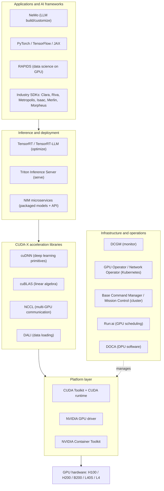
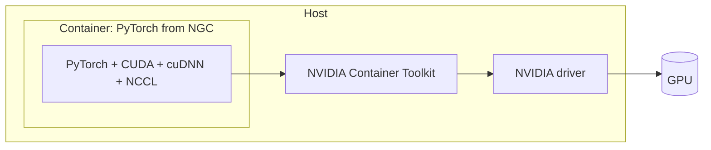

# 1.1 — The NVIDIA Software Stack in an AI Environment

> **Blueprint:** "Describe the NVIDIA software stack used in an AI environment."
> **Domain 1 — Essential AI Knowledge (38%)**

## 1. Key idea

The NVIDIA software stack has layers. Each layer uses the layer below it.
The GPU hardware is at the bottom. AI applications are at the top.
You must know the name of each layer and what it does.

## 2. The stack (diagram)

## 3. Layer by layer

| Layer | Component | What it does | Remember this |
|---|---|---|---|
| Driver | **NVIDIA GPU driver** | Lets the OS talk to the GPU. | Install on the host. Containers share the host driver. |
| Platform | **CUDA** | Parallel programming model and toolkit for NVIDIA GPUs. | CUDA is the base of all NVIDIA acceleration. |
| Container | **NVIDIA Container Toolkit** | Gives containers access to GPUs. | Use `docker run --gpus all ...` |
| Library | **cuDNN** | Fast primitives for neural networks (convolution, attention, etc.). | Frameworks call cuDNN. |
| Library | **cuBLAS** | GPU matrix math (BLAS). | Matrix multiply is the core of deep learning. |
| Library | **NCCL** ("nickel") | Collective communication: all-reduce, broadcast, all-gather between GPUs and nodes. | Multi-GPU **training** uses NCCL. It uses NVLink, InfiniBand, RoCE. |
| Library | **DALI** | Data loading and augmentation on the GPU. | Removes the CPU data bottleneck. |
| Data science | **RAPIDS** (cuDF, cuML, cuGraph) | GPU versions of pandas, scikit-learn, NetworkX. | ETL and classic ML on GPUs. |
| Optimize | **TensorRT** | Optimizes a trained model for inference: layer fusion, precision calibration (FP16/FP8/INT8), kernel auto-tuning. | **Inference optimizer**, not a server. |
| Optimize | **TensorRT-LLM** | TensorRT for large language models (in-flight batching, paged KV cache). | LLM inference speed. |
| Serve | **Triton Inference Server** | Open-source inference server. Serves models from many frameworks (TensorRT, PyTorch, ONNX, TensorFlow, Python). Dynamic batching, concurrent model execution, HTTP/gRPC. NVIDIA now ships it as part of **Dynamo**. | **Model serving**. |
| Package | **NIM** (NVIDIA Inference Microservices) | Prebuilt containers: model + optimized engine + standard API (OpenAI-compatible for LLMs). | Fastest way to deploy a model. Part of NVIDIA AI Enterprise. |
| Build LLMs | **NeMo** | Framework to build, customize, and deploy generative AI models. | Training/fine-tuning LLMs. |
| Catalog | **NGC** | NVIDIA GPU Cloud catalog: containers, pre-trained models, Helm charts, SDKs. | Download optimized containers from `nvcr.io`. |
| Enterprise | **NVIDIA AI Enterprise** | Licensed, supported software suite (NIM, NeMo, RAPIDS, Triton, TensorRT, GPU Operator, etc.). | Enterprise support + security patches. |
| Operations | **DCGM** | Data Center GPU Manager. Health, diagnostics, telemetry. | Monitoring (see 3.3). |
| Operations | **GPU Operator** | Kubernetes operator. Installs driver, container toolkit, device plugin, DCGM exporter, MIG manager. | GPUs in Kubernetes (see 3.2). |
| Operations | **Base Command Manager** | Cluster provisioning and management (formerly Bright Cluster Manager). | Manage DGX clusters. |
| Operations | **Mission Control** | Full-stack operations software for DGX AI factories (includes Base Command Manager and Run:ai). | Operate large DGX deployments. |
| Operations | **Run:ai** | Kubernetes GPU orchestration: quotas, fractional GPUs, fair-share. | Raise GPU utilization. |
| DPU | **DOCA** | SDK for BlueField DPUs. | DPU = "CUDA for the network". |

## 4. Containers: why NVIDIA uses them

1. A container holds the framework, CUDA libraries, and app.
2. The **host** holds only the driver.
3. The NVIDIA Container Toolkit maps GPU devices and driver libraries into the container.
4. Result: the same container runs on a laptop GPU, a DGX, or a cloud GPU.

## 5. Exam traps

- **TensorRT** optimizes. **Triton** serves. **NIM** packages a model as a microservice (often Triton/TensorRT-LLM inside).
- **NCCL** is for GPU-to-GPU communication. It is **not** a monitoring tool.
- **DCGM** monitors GPUs. **DOCA** programs DPUs. Do not mix them.
- **NGC** is a catalog (registry). **NVIDIA AI Enterprise** is the supported software license.
- **CUDA** is required by all other layers.

## 6. Self-check

1. Which component reduces model precision to INT8 to speed up inference? → TensorRT
2. Which component does all-reduce across 64 GPUs? → NCCL
3. Where do you download a GPU-optimized PyTorch container? → NGC (`nvcr.io`)
4. Which Kubernetes component installs the GPU driver as a container? → GPU Operator

➡️ Lab: [Lab 03 — NGC containers and the software stack](../labs/lab03-ngc-containers/README.md)
