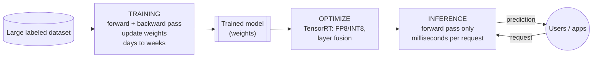
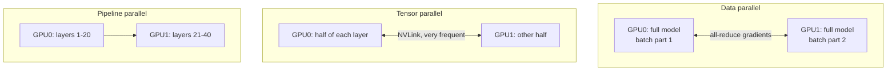

# 1.2 — Training vs Inference: Architecture Requirements

> **Blueprint:** "Compare and contrast training and inference architecture requirements and considerations."

## 1. Key idea

- **Training** teaches a model. It changes the model weights. It needs very much compute, memory, and fast GPU-to-GPU networks.
- **Inference** uses a trained model to make predictions. The weights do not change. It needs low latency, high throughput, and low cost per request.

## 2. Comparison table (memorize)

| Factor | Training | Inference |
|---|---|---|
| Goal | Learn weights | Use weights |
| Computation | Forward **and** backward pass (gradients) | Forward pass only |
| Main metric | Time-to-train, throughput (samples/s) | **Latency** (ms), throughput (requests/s, tokens/s), cost per query |
| Compute need | Very high. Many GPUs, many nodes | Lower per request. Scales out with user demand |
| Memory need | Weights + gradients + optimizer states + activations (~4x or more than weights) | Weights + KV cache (LLMs) + activations for one batch |
| Precision | FP32, TF32, **BF16/FP16** mixed precision, FP8 | **FP16, FP8, INT8, FP4** (lower precision = faster, smaller) |
| Batch size | Large batches | Small or dynamic batches |
| Network | **East-west** GPU-to-GPU: NVLink + InfiniBand/RoCE 400 Gb/s per GPU. All-reduce with NCCL | **North-south** client traffic. Standard Ethernet often is enough |
| Storage | High-throughput parallel file system for datasets and checkpoints | Fast model load. Less dataset I/O |
| Duration | Batch job: hours to months | Always-on service, 24/7 |
| Typical hardware | DGX/HGX B200, H200, H100, GB200 NVL72 | L4, L40S, H100/H200, B200, Jetson at the edge |
| Software | PyTorch, NeMo, NCCL, Megatron, DALI | TensorRT, TensorRT-LLM, Triton, NIM, Dynamo |
| Scheduling | Slurm or Kubernetes batch jobs, gang scheduling | Kubernetes deployments, autoscaling |

## 3. Why training needs more memory

For a model with **P** parameters, mixed-precision training with the Adam optimizer uses about **16 bytes per parameter** (weights, gradients, optimizer states), before activations.

| Model | Inference (FP16, 2 B/param) | Training (~16 B/param) |
|---|---|---|
| 7B | ~14 GB | ~112 GB → more than one 80 GB GPU |
| 70B | ~140 GB | ~1.1 TB → many GPUs |

Run the calculator: [`labs/lab04-sizing-calculator`](../labs/lab04-sizing-calculator/README.md).

## 4. Parallelism in training

- **Data parallel:** copy the model to each GPU. Split the data. Use all-reduce to sync gradients.
- **Tensor parallel:** split each layer across GPUs. Needs the fastest link → keep it **inside a node on NVLink**.
- **Pipeline parallel:** split layers into stages across GPUs or nodes.

## 5. Inference considerations

- **Latency vs throughput:** bigger batches raise throughput but also raise latency. Triton **dynamic batching** finds a balance.
- **LLM metrics:** time to first token (TTFT), inter-token latency, tokens per second.
- **Quantization:** FP8/INT8/FP4 reduces memory and raises speed with small accuracy loss.
- **Scale out:** add more replicas behind a load balancer. Use Kubernetes autoscaling.
- **Edge inference:** Jetson modules, low power, near the data source.

## 6. Exam traps

- "Lowest latency for a chatbot" → inference optimization (TensorRT-LLM, Triton/NIM), **not** a bigger training cluster.
- "Large model training across nodes" → InfiniBand/NVLink, NCCL, high-bandwidth storage.
- Inference **can** need multiple GPUs when the model does not fit in one GPU's memory.
- Training is **compute-bound** and **communication-bound**. LLM inference decode is often **memory-bandwidth-bound**.

## 7. Self-check

1. Which workload needs gradients and optimizer states? → Training
2. Which metric matters most for a real-time fraud check? → Latency
3. Which precision is most common for modern training? → BF16 (mixed precision), with FP8 on Hopper/Blackwell
4. Which traffic direction dominates in distributed training? → East-west
