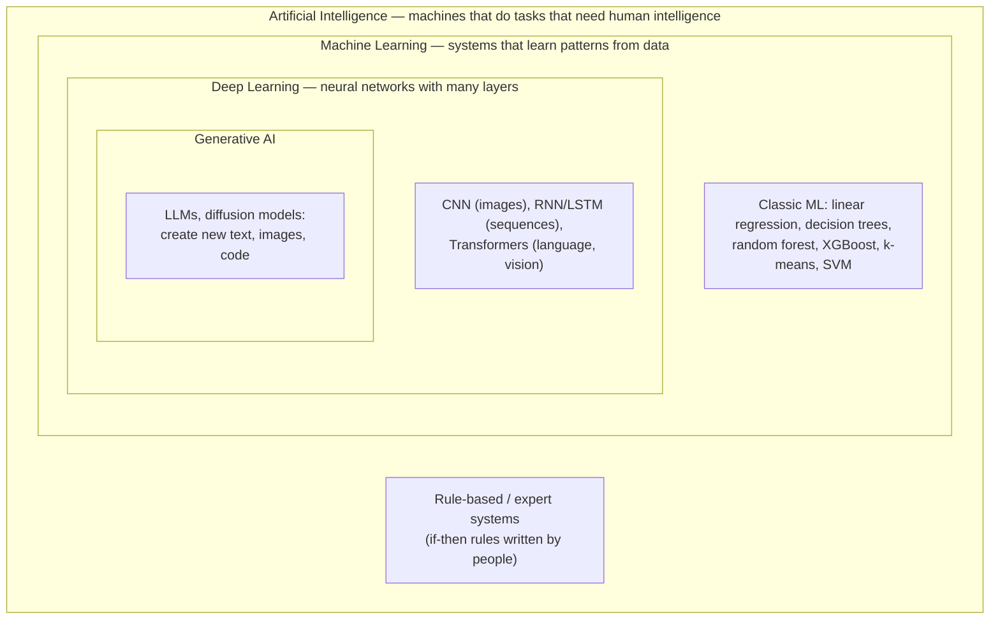
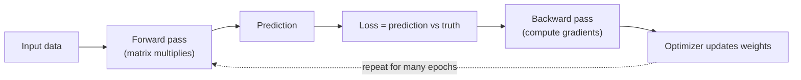

# 1.3 — AI vs Machine Learning vs Deep Learning

> **Blueprint:** "Differentiate the concepts of AI, machine learning, and deep learning."

## 1. Key idea

The three terms are **nested**. Deep learning is a type of machine learning. Machine learning is a type of AI.

## 2. Definitions

| Term | Definition | Feature engineering | Data need | Compute need |
|---|---|---|---|---|
| **AI** | Any technique that lets a computer imitate human intelligence. | — | — | — |
| **Machine learning (ML)** | Algorithms learn patterns from data. A person does not program each rule. | **Manual**. Experts choose the features. | Small to medium | CPU is often enough |
| **Deep learning (DL)** | ML with multi-layer neural networks. The network learns the features itself. | **Automatic** | Large | **GPU** (matrix math) |
| **Generative AI** | DL models that create new content. | Automatic | Very large | Very large GPU clusters |

## 3. Types of machine learning

| Type | Data | Example |
|---|---|---|
| **Supervised** | Labeled (input + correct answer) | Spam detection, image classification, price prediction |
| **Unsupervised** | Unlabeled | Customer clustering, anomaly detection |
| **Reinforcement** | Rewards from an environment | Robots, games, RLHF for LLMs |
| **Self-supervised** | Labels come from the data itself | LLM pre-training (predict the next token) |

## 4. How a neural network learns

Each layer is mostly **matrix multiplication**. Matrix multiplication is highly parallel. This is why GPUs (and Tensor Cores) accelerate deep learning.

## 5. Key vocabulary

- **Model:** the learned function (architecture + weights).
- **Parameter / weight:** a number the model learns.
- **Epoch:** one full pass over the training dataset.
- **Batch:** a group of samples processed together.
- **Inference:** using a trained model to predict.
- **Transformer:** neural network architecture that uses **attention**. It is the base of LLMs.
- **Token:** a piece of text (word or part of a word) that an LLM processes.
- **Fine-tuning:** more training of a pre-trained model on a smaller, specific dataset.
- **RAG (retrieval-augmented generation):** the LLM gets relevant documents from a vector database before it answers.

## 6. Exam traps

- "Learns features automatically from raw data" → **deep learning**.
- "Expert writes rules" → AI, but **not** ML.
- "Model predicts with labeled training data" → supervised learning.
- An LLM is deep learning **and** generative AI **and** ML **and** AI.

## 7. Self-check

1. A random forest model is ML or DL? → ML (classic, not deep)
2. Which needs the most data and compute: rule-based AI, classic ML, or DL? → DL
3. Clustering customers with no labels is which type? → Unsupervised
