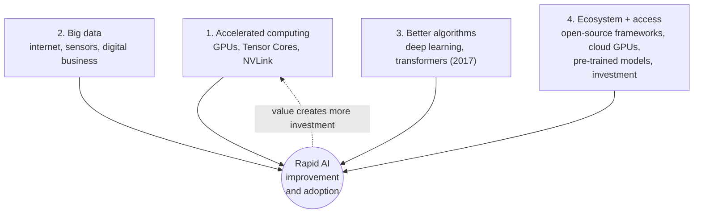

# 1.4 — Why AI Improved and Grew So Fast

> **Blueprint:** "Explain the factors contributing to recent rapid improvements and adoption of AI."

## 1. Key idea

Four forces work together. Each force makes the others stronger.

## 2. The factors

| Factor | Explanation | Example |
|---|---|---|
| **GPU / accelerated computing** | GPUs run thousands of parallel operations. Deep learning training went from months to days. NVIDIA GPU performance for AI grew by orders of magnitude in ten years. | AlexNet (2012) trained on 2 GPUs. Today's LLMs train on thousands of GPUs. |
| **Big data** | Deep learning gets better with more data. Digital life creates huge datasets. | ImageNet, web-scale text corpora. |
| **Algorithms** | New architectures and training methods. | CNNs, **transformers** with attention (2017), mixed-precision training, RLHF. |
| **Software frameworks** | Easy tools hide the complexity. | PyTorch, TensorFlow, CUDA, cuDNN, NGC containers. |
| **Cloud computing** | Anyone can rent GPUs by the hour. No large capital cost. | GPU instances on AWS/Azure/GCP/OCI, DGX Cloud. |
| **Pre-trained / foundation models** | Teams fine-tune an existing model. They do not train from zero. | LLMs, NIM microservices. |
| **Investment and business value** | Clear ROI drives more money into AI. | AI factories, sovereign AI. |

## 3. Scaling laws (simple version)

Model quality improves in a predictable way when you increase **compute**, **data**, and **model size** together. This drives demand for larger GPU clusters ("AI factories").

## 4. Exam traps

- The **main hardware** factor is the GPU (parallel processing), not faster CPUs.
- **Transformers** are the key algorithm change for modern generative AI.
- Cloud makes AI **accessible** (low entry cost), not always cheaper at large steady scale.

## 5. Self-check

1. Which 2017 architecture enabled modern LLMs? → Transformer
2. Name the three things that scaling laws increase together. → Compute, data, model size
3. How did cloud computing help AI adoption? → Pay-as-you-go access to GPUs with no upfront hardware cost
