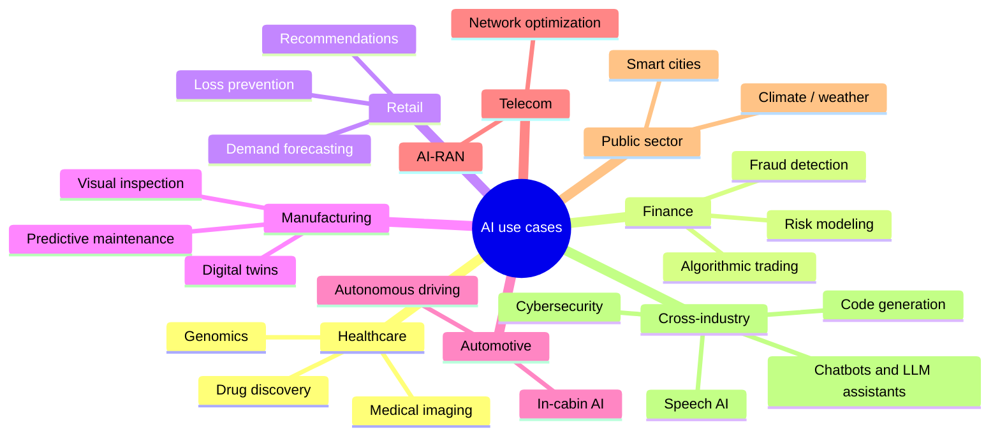
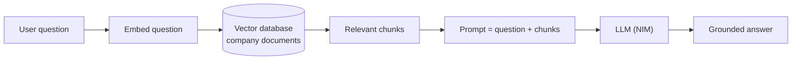

# 1.5 — Key AI Use Cases and Industries

> **Blueprint:** "Explain the key AI use cases and industries."

## 1. Key idea

The exam asks you to match an industry problem to an AI technique (and sometimes to an NVIDIA platform).

## 2. Use case → technique → NVIDIA platform

| Industry | Use case | AI technique | NVIDIA platform |
|---|---|---|---|
| Healthcare | Medical image analysis | Computer vision (CNN, segmentation) | **Clara** (MONAI), **BioNeMo** for drug discovery |
| Finance | Fraud detection | Classic ML (XGBoost) + graph neural networks, real-time inference | RAPIDS, Triton |
| Retail / e-commerce | Product recommendations | Recommender systems (embeddings) | **Merlin** |
| Retail / cities | Video analytics, loss prevention, traffic | Computer vision at the edge | **Metropolis**, DeepStream |
| Manufacturing | Defect detection | Computer vision | Metropolis, Jetson |
| Manufacturing | Digital twin of a factory | Simulation + AI | **Omniverse** |
| Automotive | Self-driving cars | Perception, sensor fusion, planning | **DRIVE** |
| Robotics | Warehouse robots | Reinforcement learning, simulation | **Isaac** |
| Contact center | Speech-to-text, text-to-speech, translation | Speech AI | **Riva** |
| Cybersecurity | Threat and anomaly detection | Streaming anomaly detection | **Morpheus** |
| All industries | Chatbots, summarization, RAG, agents | Generative AI / LLMs | **NeMo**, **NIM** |
| Video conferencing | Noise removal, eye contact, super-resolution | Generative / vision AI | **Maxine** |
| Science | Weather/climate prediction | Physics-ML | Earth-2, Modulus (PhysicsNeMo) |

## 3. Generative AI patterns (very common on the exam)

- **RAG:** add company knowledge without retraining. Reduces hallucination.
- **Fine-tuning:** change model behavior or domain style.
- **Agents:** LLMs that plan and call tools.

## 4. Exam traps

- "Recommender system" → Merlin. "Speech" → Riva. "Video analytics" → Metropolis. "Cybersecurity" → Morpheus. "Healthcare/imaging" → Clara. "Robots" → Isaac. "Digital twin / 3D simulation" → Omniverse.
- Fraud detection needs **low-latency inference** at transaction time.

## 5. Self-check

1. A bank wants to block card fraud in under 50 ms. Training or inference requirement? → Inference (low latency)
2. A retailer wants "customers also bought" lists. Which NVIDIA framework? → Merlin
3. A company wants an LLM to answer from internal PDFs without retraining. Which pattern? → RAG
