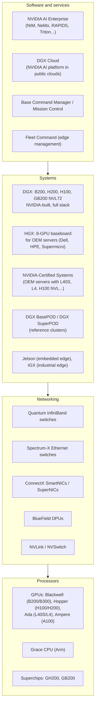
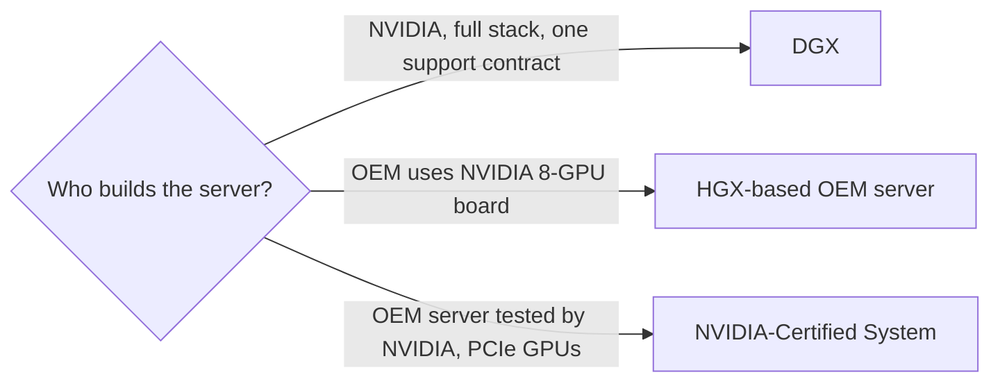

# 1.6 — Purpose and Use Case of NVIDIA Solutions

> **Blueprint:** "Explain the purpose and use case of various NVIDIA solutions."

## 1. Key idea

NVIDIA sells a **full stack**: chips → systems → networking → software → cloud services. The exam gives a need and asks which product fits.

## 2. GPU architectures (newest first)

| Architecture | Example data center products | Key new features |
|---|---|---|
| **Blackwell** (2024–) | B200, B300 (Blackwell Ultra), GB200/GB300 NVL72 | 2nd-gen Transformer Engine, **FP4**, 5th-gen NVLink (1.8 TB/s per GPU), 192 GB HBM3e |
| **Hopper** (2022–) | H100, H200, GH200 | **Transformer Engine**, **FP8**, 4th-gen NVLink (900 GB/s), HBM3 / HBM3e |
| **Ada Lovelace** (2022–) | L40S, L4 | Graphics + AI inference, FP8, video, lower power |
| **Ampere** (2020–) | A100, A30, A10 | 3rd-gen Tensor Cores, **TF32**, **MIG** (first), 3rd-gen NVLink |
| **Vera Rubin** (announced next gen) | Vera Rubin NVL72 | Next after Blackwell |

## 3. Product guide

| Product | What it is | Use when |
|---|---|---|
| **DGX B200 / H200 / H100** | NVIDIA's own 8-GPU AI server with NVSwitch, networking, and software | Turnkey enterprise AI training and inference |
| **DGX GB200 NVL72** | Rack-scale system: 72 Blackwell GPUs + 36 Grace CPUs in one NVLink domain, **liquid-cooled** | Trillion-parameter LLM training and real-time inference |
| **HGX** | 8-GPU baseboard (GPUs + NVSwitch) that OEMs put in their servers | You want an OEM server (Dell, HPE, Lenovo, Supermicro) with DGX-class GPUs |
| **DGX BasePOD** | Reference architecture: 2+ DGX nodes + networking + storage | Small/medium cluster |
| **DGX SuperPOD** | Reference architecture for large clusters, built from **Scalable Units (SU) of 32 DGX nodes** | Large AI factory |
| **GH200 / GB200 Superchip** | Grace CPU + GPU connected with **NVLink-C2C** (900 GB/s) | Large memory, CPU-GPU coherent workloads |
| **L40S** | Universal PCIe GPU, 48 GB, graphics + AI | Inference, fine-tuning, Omniverse, rendering |
| **L4** | Low-power (72 W) PCIe GPU | Efficient inference, video AI at scale |
| **H100 NVL / RTX PRO 6000 Blackwell Server Edition** | PCIe data center GPUs | Mainstream servers for inference |
| **Jetson** (Orin, Thor) | Embedded AI computer | Robots, drones, edge devices |
| **IGX** | Industrial-grade edge platform with safety | Medical devices, factories |
| **DGX Cloud** | NVIDIA AI platform hosted in public clouds | No on-prem hardware; fast start |
| **NVIDIA AI Enterprise** | Supported, licensed AI software suite | Production support and security |
| **Omniverse** | 3D simulation and digital twins (OpenUSD) | Factory twins, synthetic data |
| **Fleet Command** | Cloud service to deploy and manage AI at many edge sites | Retail stores, hospitals |
| **BlueField DPU** | Data processing unit (see 2.10) | Offload networking, storage, security |
| **ConnectX** | High-speed NIC (InfiniBand or Ethernet) | Server network connectivity |
| **Quantum InfiniBand** | InfiniBand switches (NDR 400 Gb/s, XDR 800 Gb/s) | Lowest-latency AI training fabric |
| **Spectrum-X** | AI-optimized Ethernet: Spectrum-4 switch + BlueField-3 SuperNIC | AI cloud on Ethernet |

## 4. DGX vs HGX vs Certified (common question)

## 5. Exam traps

- **HGX** is a **board/platform** for partners. **DGX** is a **complete system** from NVIDIA.
- **MIG** first appeared with **Ampere (A100)**.
- **FP8 + Transformer Engine** first appeared with **Hopper**. **FP4** with **Blackwell**.
- **Grace** is a CPU. **GH200/GB200** are CPU+GPU superchips.
- **GB200 NVL72** needs **liquid cooling**.

## 6. Self-check

1. Which product lets an OEM build an 8-GPU server with NVSwitch? → HGX
2. Which GPU is best for low-power video inference at scale? → L4
3. Which architecture introduced FP4? → Blackwell
4. What is the building block of a DGX SuperPOD? → Scalable Unit (32 DGX nodes)
