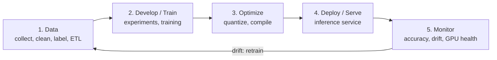
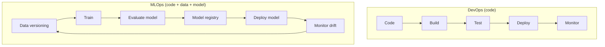

# 1.7 — Software in the AI Development and Deployment Life Cycle

> **Blueprint:** "Describe the software components related to the life cycle of AI development and deployment."

## 1. Key idea

An AI project follows a life cycle. Each stage uses specific software. **MLOps** automates the full cycle.

## 2. Stage → software

| Stage | Task | NVIDIA software | Common open-source / other |
|---|---|---|---|
| 1. Data | ETL, feature engineering | **RAPIDS** (cuDF, Spark RAPIDS accelerator) | pandas, Apache Spark |
| 1. Data | Data loading, augmentation | **DALI** | PyTorch DataLoader |
| 1. Data | Synthetic data | **Omniverse Replicator**, NeMo Curator | — |
| 2. Train | Deep learning framework | **NGC** containers for PyTorch/TensorFlow/JAX | PyTorch, TensorFlow, JAX |
| 2. Train | LLM building, fine-tuning | **NeMo** | Hugging Face, DeepSpeed |
| 2. Train | Multi-GPU communication | **NCCL** | — |
| 2. Train | Classic ML | **cuML**, XGBoost on GPU | scikit-learn |
| 2. Train | Transfer learning (vision) | TAO Toolkit | — |
| 3. Optimize | Inference optimization | **TensorRT**, **TensorRT-LLM**, TensorRT Model Optimizer | ONNX Runtime |
| 4. Deploy | Model serving | **Triton Inference Server** / Dynamo, **NIM** | KServe, vLLM |
| 4. Deploy | Container platform | NVIDIA Container Toolkit, **GPU Operator** | Docker, Kubernetes |
| 5. Monitor | GPU telemetry | **DCGM**, DCGM Exporter | Prometheus, Grafana |
| All | Experiment tracking, pipelines | — | MLflow, Kubeflow, Weights & Biases |
| All | Scheduling / orchestration | **Run:ai**, Base Command Manager | Kubernetes, Slurm |
| All | Supported enterprise suite | **NVIDIA AI Enterprise** | — |

## 3. MLOps vs DevOps

MLOps adds:
- **Data versioning** and **model versioning** (model registry).
- **Model evaluation** (accuracy, bias) before deploy.
- **Drift monitoring:** real-world data changes over time. Accuracy drops. Retrain.
- **Reproducibility:** same container, same data, same code → same model.

## 4. Exam traps

- **DALI** fixes CPU data-loading bottlenecks during training.
- **RAPIDS** accelerates data science/ETL, not deep learning inference.
- **TensorRT** is in the optimize stage. **Triton/NIM** is in the deploy stage.
- **NGC** gives tested, optimized containers for every stage.

## 5. Self-check

1. GPUs show low utilization because JPEG decoding on the CPU is slow. Which tool helps? → DALI
2. Which tool serves PyTorch, ONNX, and TensorRT models from one server? → Triton
3. What is model drift? → The production data changes, so model accuracy drops over time
