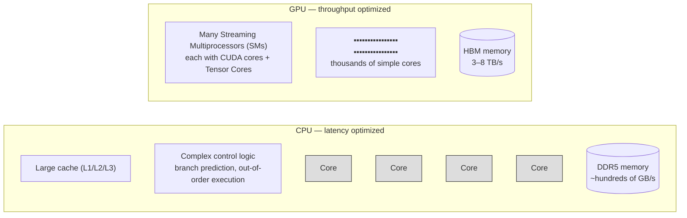
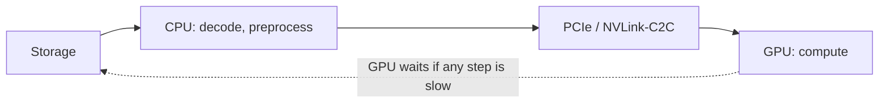

# 1.8 — GPU vs CPU Architecture

> **Blueprint:** "Compare and contrast GPU and CPU architectures."

## 1. Key idea

- A **CPU** has a **small number of powerful cores**. It is optimized for **low latency** on serial tasks with complex logic.
- A **GPU** has **thousands of simple cores**. It is optimized for **high throughput** on parallel tasks (the same operation on much data).

## 2. Comparison table

| Feature | CPU | GPU |
|---|---|---|
| Cores | Tens (up to ~200) powerful cores | Thousands of CUDA cores in ~100+ SMs |
| Design goal | Low latency per task | High throughput across many tasks |
| Execution | Out-of-order, branch prediction, speculative | **SIMT**: one instruction, many threads. Threads run in **warps of 32** |
| Cache | Large per core | Smaller per thread. Uses massive parallelism to hide memory latency |
| Memory | DDR (high capacity, lower bandwidth) | **HBM** (high bandwidth: H100 3.35 TB/s, H200 4.8 TB/s, B200 8 TB/s) |
| Best for | OS, databases, control flow, serial code, data preparation | Matrix math, deep learning, simulation, graphics, video |
| Special units | Vector units (AVX-512, AMX) | **Tensor Cores** (matrix multiply-accumulate in FP16/BF16/FP8/FP4) |
| Role in AI server | Host: runs OS, schedules work, loads data | Accelerator: runs the math |

## 3. GPU terms you must know

| Term | Meaning |
|---|---|
| **SM (Streaming Multiprocessor)** | The GPU building block. Contains CUDA cores, Tensor Cores, registers, shared memory. |
| **CUDA core** | Simple processing unit for FP32/INT32 operations. |
| **Tensor Core** | Special unit for matrix multiply-accumulate. Main engine for AI. |
| **Transformer Engine** | Hopper/Blackwell feature that picks FP8 (or FP4) vs 16-bit per layer automatically. |
| **Warp** | Group of 32 threads that execute the same instruction together. |
| **Kernel** | A function that runs on the GPU across many threads. |
| **HBM** | High Bandwidth Memory, stacked next to the GPU die. |
| **Host / device** | Host = CPU + system memory. Device = GPU + GPU memory. |
| **PCIe** | Bus between CPU and GPU (Gen5 x16 ≈ 64 GB/s each direction). |
| **NVLink** | Direct, much faster GPU-to-GPU link (H100: 900 GB/s total per GPU). |

## 4. Amdahl's law (why the CPU still matters)

Only the parallel part of a program gets faster on a GPU. If 10% of the work is serial, the maximum speedup is 10x, even with infinite GPUs. Keep the **data pipeline** (CPU, storage, network) fast so the GPU does not wait.

## 5. Exam traps

- GPUs are **not** faster for every task. Serial, branch-heavy code is better on CPUs.
- **Throughput** = GPU. **Latency for a single serial task** = CPU.
- Tensor Cores ≠ CUDA cores. Tensor Cores do matrix math for AI.
- GPU memory bandwidth (HBM) is much higher than CPU memory bandwidth.

## 6. Self-check

1. How many threads are in a warp? → 32
2. Which GPU unit accelerates matrix multiply in mixed precision? → Tensor Core
3. Why does a GPU have smaller caches than a CPU? → It hides memory latency with many parallel threads instead of large caches

➡️ Lab: [Lab 01 — CPU vs GPU benchmark](../labs/lab01-cpu-vs-gpu/README.md)
