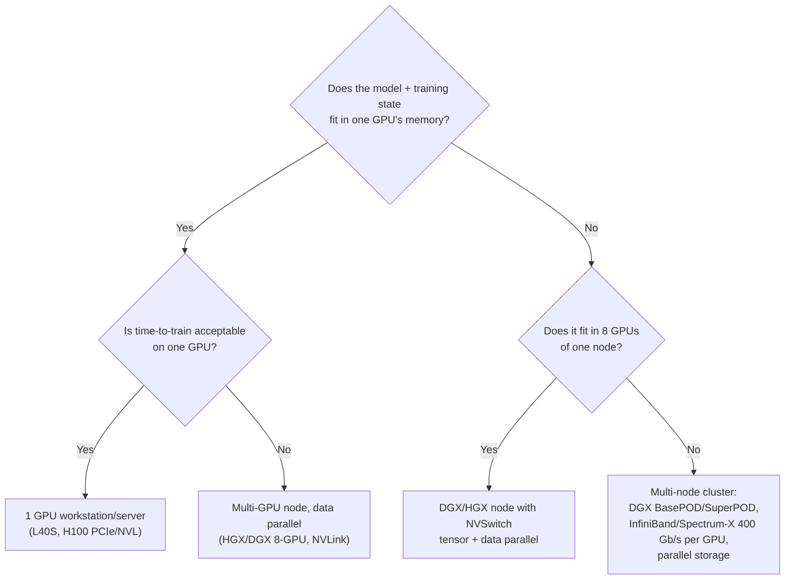

# 2.1 — Hardware Requirements for AI Training Use Cases

> **Blueprint:** "Identify hardware requirements for specific AI training task use cases."
> **Domain 2 — AI Infrastructure (40%)**

## 1. Key idea

Pick hardware from the **workload**. Ask four questions:

## 2. The four resources

| Resource | Why it matters for training | What to choose |
|---|---|---|
| **GPU compute** (FLOPS) | Sets time per training step | Newer architecture + low precision (BF16/FP8/FP4) |
| **GPU memory** (capacity + bandwidth) | Model, gradients, optimizer state, activations must fit | H100 80 GB, H200 141 GB, B200 192 GB (180 GB usable in DGX B200) |
| **Interconnect** | Gradient sync and tensor parallel traffic | NVLink/NVSwitch inside node; InfiniBand or RoCE Ethernet between nodes |
| **Storage I/O** | Feed data and save checkpoints | NVMe local cache + parallel file system; GPUDirect Storage |

Also: **CPU cores and system RAM** for data loading (DGX H100: 2x 56-core Xeon, 2 TB RAM).

## 3. Reference system: DGX H100 (know these numbers)

| Item | DGX H100 |
|---|---|
| GPUs | 8x H100 SXM5, **80 GB** each → **640 GB** total |
| GPU-to-GPU | 4th-gen NVLink, **900 GB/s** per GPU, through **4 NVSwitch** chips |
| Performance | 32 PFLOPS FP8 |
| CPUs | 2x Intel Xeon Platinum 8480C (112 cores total) |
| System memory | 2 TB |
| Compute network | **8x ConnectX-7**, 400 Gb/s each (one per GPU), InfiniBand/Ethernet |
| Storage network | 2x dual-port ConnectX-7 |
| Management | 10 GbE + **BMC** port (out-of-band) |
| Storage | OS: 2x 1.92 TB NVMe; data cache: 8x 3.84 TB NVMe |
| Power | **~10.2 kW max** |
| Size | 8U |

| Item | DGX B200 |
|---|---|
| GPUs | 8x Blackwell, **1,440 GB** total HBM3e, 64 TB/s total bandwidth |
| GPU-to-GPU | 5th-gen NVLink, **2 NVSwitch** chips, **14.4 TB/s** aggregate (1.8 TB/s per GPU) |
| Performance | 72 PFLOPS FP8 training, 144 PFLOPS FP4 inference |
| CPUs | 2x Intel Xeon Platinum 8570 (112 cores) |
| Power | **~14.3 kW max** |
| Size | 10U |

## 4. Use case → hardware

| Use case | Typical requirement |
|---|---|
| Fine-tune a 7B LLM with LoRA | 1–2 GPUs with 48–80 GB (L40S, H100) |
| Full fine-tune of a 70B LLM | Several 8-GPU nodes, NVLink + InfiniBand |
| Pre-train a frontier LLM | Thousands of GPUs: SuperPOD or GB200 NVL72 racks, liquid cooling |
| Computer vision model (ResNet, YOLO) | 1–8 GPUs; fast storage for images; DALI |
| Recommender system with huge embedding tables | Large GPU memory and fast CPU-GPU links (Grace Hopper, multi-GPU embeddings) |
| Classic ML (XGBoost) on large tables | 1–few GPUs with RAPIDS |
| Scientific simulation (FP64 HPC) | GPUs with strong FP64 (H100/H200) |

## 5. Memory estimate rule of thumb

| Need | Bytes per parameter |
|---|---|
| Inference FP16/BF16 | 2 |
| Inference FP8 / INT8 | 1 |
| Inference FP4 | 0.5 |
| Training, mixed precision + Adam | ~16 (plus activations) |

Example: 70B parameters × 16 B = 1,120 GB → more than one DGX H100 (640 GB). Use multi-node or memory-saving methods (sharding, activation checkpointing).

## 6. Exam traps

- **SXM** GPUs (on HGX/DGX boards) support full NVLink/NVSwitch and higher power. **PCIe** cards are for standard servers.
- One NIC per GPU (**1:1 GPU-to-NIC ratio**) is the DGX design for multi-node training.
- Training scale is limited by the **slowest** resource: compute, memory, network, or storage.

## 7. Self-check

1. Total GPU memory in a DGX H100? → 640 GB
2. How many 400 Gb/s compute NICs in a DGX H100? → 8 (one per GPU)
3. Model needs 900 GB for training. One DGX H100 enough? → No (640 GB) — use two or more nodes

➡️ Lab: [Lab 04 — GPU sizing calculator](../labs/lab04-sizing-calculator/README.md)
