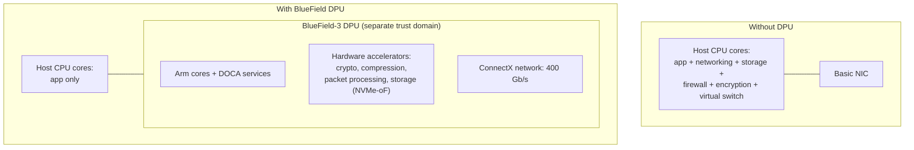

# 2.10 — The DPU: Purpose and Benefits

> **Blueprint:** "Explain the purpose and benefits of a DPU in a data center."

## 1. Key idea

A modern data center has **three processors**:

- **CPU** — general-purpose compute.
- **GPU** — accelerated compute.
- **DPU** (Data Processing Unit) — **infrastructure** processing: networking, storage, and security.

The DPU takes infrastructure work **off the CPU** so the CPU (and GPU) do the real application work. It also **isolates** the infrastructure from the host, which improves security.

## 2. What is inside a BlueField DPU?

| Part | Purpose |
|---|---|
| **ConnectX network adapter** | High-speed InfiniBand/Ethernet (BlueField-3: up to 400 Gb/s) |
| **Arm CPU cores** | Run infrastructure software (a separate OS on the DPU) |
| **Hardware accelerators** | Encryption (IPsec/TLS), regex, compression, storage, packet processing |
| **Own memory** | Separate from the host |
| **DOCA SDK** | Software framework to program the DPU ("CUDA for DPUs") |

## 3. Benefits

| Benefit | Explanation |
|---|---|
| **Offload** | Network virtualization (OVS), storage protocols, telemetry run on the DPU. Frees host CPU cores. |
| **Accelerate** | Hardware engines do encryption and packet processing at line rate. |
| **Isolate (zero trust)** | Security controls run on the DPU, **outside** the host OS. If the host is compromised, the firewall still works. |
| **Bare-metal cloud / multi-tenancy** | Providers manage networking and storage on the DPU while the tenant gets the whole host. |
| **Storage** | NVMe over Fabrics (NVMe-oF), storage virtualization (BlueField SNAP: remote storage looks like a local NVMe disk). |
| **Efficiency** | Better performance per watt for infrastructure tasks. |

## 4. DPU vs SmartNIC vs SuperNIC

| Device | Main job |
|---|---|
| **NIC** | Moves packets. |
| **SmartNIC** (e.g., ConnectX) | NIC + fixed hardware offloads (RDMA, checksums, overlay). |
| **DPU** (BlueField) | SmartNIC + programmable Arm cores + accelerators. Runs full infrastructure services. Separate trust domain. |
| **SuperNIC** (BlueField-3 SuperNIC, ConnectX-8) | Optimized for **east-west GPU traffic** in AI clusters (Spectrum-X), 400–800 Gb/s. |

## 5. Exam traps

- DPU = **networking, storage, security** offload. It does **not** train models.
- DPU = **isolation** from the host → zero-trust security.
- Programming framework is **DOCA** (not CUDA).
- In DGX B200, BlueField-3 DPUs handle storage and in-band networking; ConnectX-7 handles the compute fabric.

## 6. Self-check

1. What SDK do you use to program a BlueField DPU? → DOCA
2. Why is a firewall on the DPU safer than on the host? → It runs in a separate trust domain; a compromised host OS cannot turn it off
3. Name three workloads a DPU offloads. → Software-defined networking (virtual switch), storage (NVMe-oF), security (encryption/firewall)
