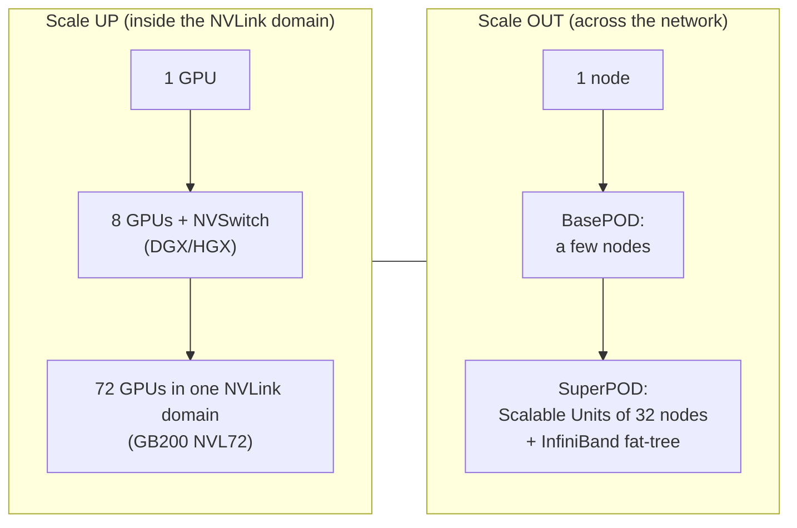
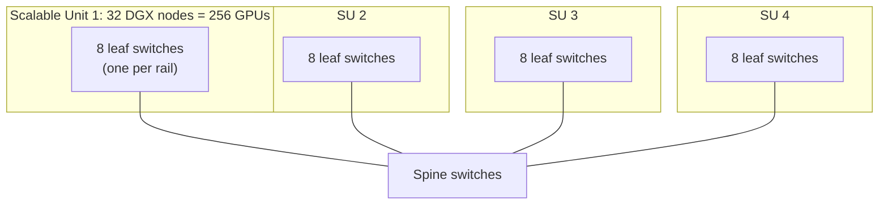

# 2.2 — Scaling GPU Infrastructure for Different Use Cases

> **Blueprint:** "Scale a GPU infrastructure for different use cases."

## 1. Key idea

There are two directions to scale:

- **Scale up:** make one node stronger (more or bigger GPUs in one NVLink domain).
- **Scale out:** add more nodes and connect them with a fast network.

| | Scale up | Scale out |
|---|---|---|
| Link | NVLink / NVSwitch (TB/s) | InfiniBand / Ethernet (400–800 Gb/s per port) |
| Latency | Lowest | Higher |
| Limit | Size of the NVLink domain | Network design, power, space |
| Best for | Tensor parallel, large models in memory | Data parallel, very large training, many inference replicas |

## 2. Scaling patterns by use case

| Use case | How to scale |
|---|---|
| **Large model training** | Scale up first (NVLink), then scale out with a non-blocking, rail-optimized InfiniBand/Spectrum-X fabric. Add parallel storage bandwidth. |
| **Inference serving** | Scale out with **more replicas** behind a load balancer. Autoscale on load (Kubernetes HPA). Use MIG to split big GPUs for small models. |
| **Many small experiments** (data scientists) | Share GPUs: MIG, time-slicing, Run:ai fractional GPUs, quotas. |
| **Edge AI** | Scale out to many sites with small devices (Jetson, L4). Manage centrally (Fleet Command). |
| **HPC simulation** | Scale out with MPI over InfiniBand; FP64-capable GPUs. |

## 3. DGX SuperPOD scaling (reference architecture)

- **SU = 32 DGX H100 (or B200) nodes** = 256 GPUs.
- The H100 reference design shows **4 SUs = 127 DGX nodes** (1 slot holds the UFM fabric manager) = ~1,016 GPUs.
- Larger designs add a **core** layer (3-tier fat-tree) and scale to thousands of nodes.
- Rack density: typically **4 DGX H100 per rack** if power and cooling allow; else 1–2 per rack (more racks).

## 4. Rules for good scaling

1. **Balance** compute, network, and storage. A faster GPU with a slow network gives low utilization.
2. Use a **non-blocking** (1:1) fabric for training. Oversubscription slows all-reduce.
3. Use **rail-optimized** topology: GPU *n* of every node connects to leaf switch *n*.
4. Plan **power and cooling** first. They are often the real limit (see 2.3).
5. **Scaling efficiency** = (speedup) / (number of GPUs). Communication overhead reduces it.

Example: 1 GPU = 100 img/s. 8 GPUs = 720 img/s. Efficiency = 720 / (8 × 100) = **90%**.

## 5. Exam traps

- Inference usually scales **out** (replicas). Big-model training needs scale **up and out**.
- Adding GPUs does **not** give linear speedup if the network is oversubscribed.
- MIG is a way to scale **down** (share one GPU), not to scale up.

## 6. Self-check

1. How many DGX nodes are in one SuperPOD Scalable Unit? → 32
2. A chatbot gets 10x more users. Scale up or out? → Out (more inference replicas)
3. Why use rail-optimized networks? → GPUs with the same index talk through one leaf switch hop, lowering latency and congestion
