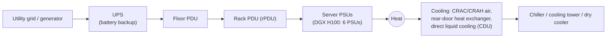
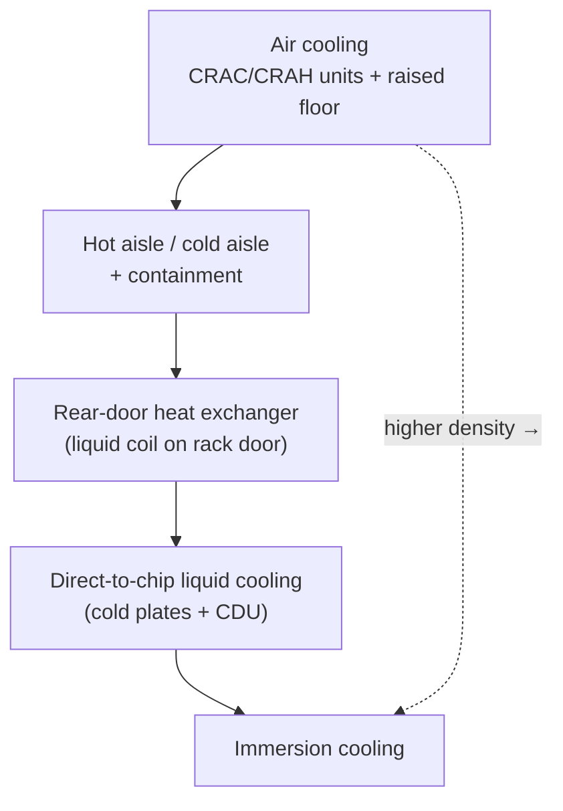

# 2.3 — Power and Cooling in the Data Center

> **Blueprint:** "Identify key concepts and high-level specifications related to power and cooling requirements within a data center."

## 1. Key idea

AI servers use much more power per rack than normal servers. **All electrical power becomes heat.** Every watt you deliver, you must also remove.

## 2. Numbers to remember

| Item | Value |
|---|---|
| Traditional enterprise rack | ~5–15 kW |
| DGX H100 | ~10.2 kW per system |
| DGX B200 | ~14.3 kW per system |
| 4x DGX H100 per rack | ~41 kW per rack |
| GB200 NVL72 rack | ~120+ kW per rack → **liquid cooling required** |
| Air cooling practical limit | roughly 30–40 kW per rack (with containment) |
| 1 W of IT power | = 3.412 BTU/hr of heat |
| 1 ton of cooling | = 12,000 BTU/hr ≈ 3.52 kW |

## 3. Key metrics

| Metric | Formula | Good value |
|---|---|---|
| **PUE** (Power Usage Effectiveness) | Total facility power ÷ IT equipment power | **1.0 is ideal**. Modern efficient sites: ~1.1–1.3. Older: 1.6–2.0 |
| **DCiE** | IT power ÷ total facility power (= 1/PUE) | Higher is better |
| **Performance per watt** | Work (tokens, samples) ÷ energy | Main efficiency metric for AI |

Example: Facility uses 1,300 kW. IT uses 1,000 kW. PUE = 1.3. 300 kW goes to cooling, lighting, and power losses.

## 4. Power redundancy

| Design | Meaning |
|---|---|
| **N** | Exactly enough capacity. No redundancy. |
| **N+1** | One extra component (e.g., one extra PSU or UPS module). |
| **2N** | Two fully independent power paths (A feed and B feed). Highest availability. |

- Connect server PSUs to **both A and B** power feeds.
- DGX systems have several PSUs with load balancing. Do **not** run them with PSUs removed.
- Use **three-phase** power for high-density racks.

## 5. Cooling methods

| Method | How it works | Use |
|---|---|---|
| **Air + hot/cold aisle** | Servers pull cold air from the front (cold aisle) and exhaust hot air to the back (hot aisle). | Up to ~30–40 kW/rack with containment |
| **Containment** | Physical walls/roofs keep hot and cold air separate. | Raises air cooling efficiency |
| **Rear-door heat exchanger** | Water coil in the rack door removes heat from exhaust air. | Retrofit for denser racks |
| **Direct liquid cooling (DLC)** | Coolant flows through cold plates on GPUs/CPUs. A **CDU** (coolant distribution unit) exchanges heat with facility water. | GB200 NVL72, high-density AI |
| **Immersion** | Servers sit in dielectric fluid. | Very high density, special use |

Liquid removes heat far better than air. It also lowers PUE because fans and chillers do less work.

## 6. Exam traps

- **Lower PUE is better.** PUE can never be below 1.0.
- Power **and** cooling are planned together: kW in = kW of heat out.
- If a data center cannot cool 40 kW per rack, put **fewer DGX systems per rack** and use more racks.
- Blackwell rack-scale systems (NVL72) are **liquid-cooled**.

## 7. Self-check

1. Facility 2 MW, IT 1.6 MW. PUE? → 1.25
2. Rack with 4x DGX H100. Approximate power? → ~41 kW
3. 2N power redundancy means? → Two independent, full-capacity power paths

➡️ Lab: [Lab 04 — sizing calculator (power, cooling, PUE)](../labs/lab04-sizing-calculator/README.md)
