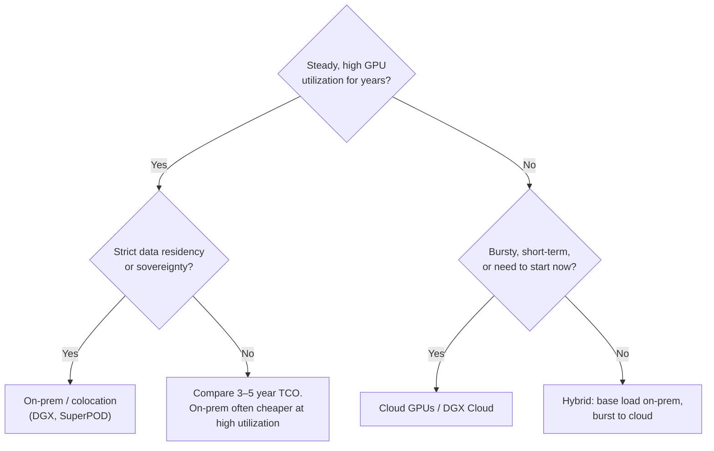

# 2.4 — On-Premises vs Cloud AI Infrastructure

> **Blueprint:** "Articulate the key advantages, challenges, and considerations related to on-prem vs cloud infrastructures."

## 1. Key idea

There is no single right answer. Choose by **utilization, data location, compliance, budget model, and speed to start**. Many companies use **hybrid**.

## 2. Comparison

| Factor | On-premises | Cloud |
|---|---|---|
| Cost model | **CapEx** (buy up front) + operating costs | **OpEx** (pay per hour/month) |
| Cost at high, steady use | Usually **lower** over 3–5 years | Can be higher |
| Cost at low/bursty use | Idle hardware wastes money | Pay only for use |
| Time to start | Weeks to months (procure, install, power, cooling) | Minutes to days (if capacity exists) |
| Scalability | Limited by purchased hardware, power, space | Elastic (but large GPU capacity can be scarce; reserve it) |
| Control | Full control of hardware, network, software | Less control; shared responsibility model |
| Data | Data stays in your facility (**data gravity**, sovereignty) | Data must move to the cloud; **egress fees** |
| Security & compliance | You own all of it | Provider secures the cloud; you secure what you put in it |
| Staff | Need data center, network, and cluster skills | Fewer facility skills needed |
| Hardware refresh | You manage the life cycle | Provider offers new GPUs |
| Latency to users/data | Good if data and users are local | Depends on region |

## 3. Key terms

- **TCO (Total Cost of Ownership):** hardware + power + cooling + space + staff + software + support over the life.
- **Data gravity:** big datasets are hard and costly to move. Compute moves to the data.
- **Data sovereignty:** law requires data to stay in a country/region.
- **Sovereign AI:** a nation builds its own AI infrastructure and models.
- **Hybrid cloud:** on-prem + cloud with a common software stack (containers from NGC, NVIDIA AI Enterprise, Kubernetes) so workloads can move.
- **Colocation:** you own the servers; a provider gives space, power, and cooling.
- **DGX Cloud:** NVIDIA's AI platform with DGX-class infrastructure in partner clouds.

## 4. Cloud GPU considerations

- **Instance types** differ: GPU model, GPU count, NVLink, network (e.g., 3,200 Gb/s per node), local NVMe.
- **Capacity:** reserve large GPU clusters ahead of time.
- **Egress costs:** moving data out of the cloud costs money.
- **Spot/preemptible** GPUs are cheap but can stop. Use checkpoints.
- **Shared responsibility:** you still manage your OS images, containers, identities, and data security.

## 5. Exam traps

- "Unpredictable, short-term demand" → **cloud**.
- "Constant 24/7 use, sensitive data, regulations" → **on-prem** (or sovereign/colocation).
- "Want both" → **hybrid** with a consistent software stack.
- Cloud is OpEx; on-prem is CapEx.

## 6. Self-check

1. A startup needs 64 GPUs for 3 weeks. Best choice? → Cloud
2. What is data gravity? → Large data is hard to move, so compute is placed near the data
3. Which cost type is buying DGX systems? → CapEx
