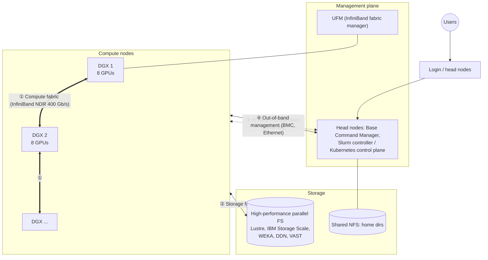
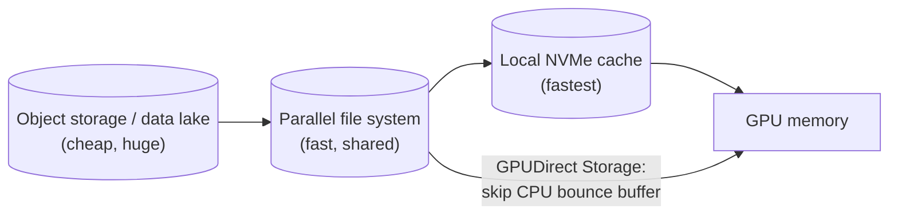

# 2.5 — Components of an Accelerated Infrastructure Cluster

> **Blueprint:** "Identify key components and considerations of a cluster of an accelerated infrastructure."

## 1. Key idea

An AI cluster is more than GPU servers. It has **compute nodes, management nodes, storage, four networks, and software**.

## 2. The four networks (DGX SuperPOD design)

| # | Network | Purpose | Technology |
|---|---|---|---|
| ① | **Compute fabric** (east-west) | GPU-to-GPU traffic between nodes (NCCL all-reduce) | InfiniBand NDR 400 Gb/s or Spectrum-X Ethernet; rail-optimized, non-blocking |
| ② | **Storage fabric** | Dataset reads, checkpoint writes | InfiniBand or high-speed Ethernet |
| ③ | **In-band management** | SSH, job control, OS updates, cluster services, user access | Ethernet (100–200 GbE) |
| ④ | **Out-of-band (OOB) management** | Hardware control through the **BMC**: power on/off, console, firmware, sensors | Separate low-speed Ethernet (1 GbE) |

## 3. Cluster components checklist

| Component | Role |
|---|---|
| **Compute nodes** | DGX/HGX servers with GPUs |
| **Head / management nodes** | Provisioning, scheduler, monitoring (Base Command Manager, Slurm controller, K8s control plane) |
| **Login nodes** | Users connect and submit jobs; no heavy compute |
| **Storage** | Parallel file system for training data; NFS for home; object storage for data lakes |
| **Local NVMe** | Cache for datasets on each node |
| **Network switches** | Quantum InfiniBand / Spectrum Ethernet leaf, spine, core |
| **Fabric manager** | **UFM** or subnet manager for InfiniBand |
| **Software stack** | OS (DGX OS / Ubuntu), drivers, CUDA, containers, scheduler, monitoring (DCGM) |
| **Facility** | Racks, PDUs, UPS, cooling (see 2.3 and 2.6) |

## 4. Storage considerations

- Training reads data many times (epochs). Caching helps.
- **Checkpoints** for big models are very large. Storage must write them fast.
- **GPUDirect Storage (GDS)** moves data directly between storage and GPU memory. It lowers CPU load and latency.

## 5. Exam traps

- **BMC** is on the **out-of-band** network. It works even if the OS is down.
- The compute fabric is for **GPU traffic only**. Do not mix user traffic on it.
- **Login nodes** are not for training jobs.
- A cluster needs a **scheduler** (Slurm or Kubernetes) to share resources.

## 6. Self-check

1. Which network lets you power-cycle a frozen node? → Out-of-band management (BMC)
2. Which network carries NCCL all-reduce traffic? → Compute fabric
3. What technology moves data from storage directly into GPU memory? → GPUDirect Storage
