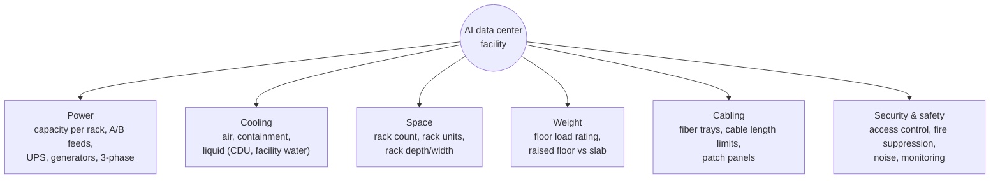

# 2.6 — Facility Requirements

> **Blueprint:** "Identify facility requirements."

## 1. Key idea

Before you buy GPUs, check that the **building** can support them: power, cooling, space, floor weight, network cabling, and safety.

## 2. Checklist

| Area | Consideration | Example |
|---|---|---|
| **Power capacity** | Total MW and kW per rack | 4x DGX H100 ≈ 41 kW per rack |
| **Power redundancy** | N+1 or 2N; A/B feeds | Two rack PDUs per rack on different feeds |
| **Power quality** | UPS for ride-through, generators for long outages | |
| **Cooling capacity** | Must match power (kW of heat) | Liquid cooling for NVL72 racks |
| **Airflow** | Front-to-back; hot/cold aisle; blanking panels | Fill empty rack units with blanking panels |
| **Rack size** | Height (U), **depth** (DGX systems are deep, ~900 mm), width | DGX H100 is 8U, DGX B200 is 10U |
| **Weight** | Floor load rating; DGX B200 ≈ 142 kg each | 4 systems + rack can exceed 700 kg |
| **Cabling** | Many fiber cables per node; cable length limits for DAC/AOC; overhead trays | DGX H100: 8 compute + storage + management cables |
| **Physical security** | Badges, cameras, cages | |
| **Fire protection** | Gas-based suppression (no water on electronics) or pre-action sprinklers | |
| **Noise** | High-density servers are loud; hearing protection | |
| **Environmental monitoring** | Temperature, humidity, leak detection (for liquid cooling) | |
| **Standards** | Uptime Institute **Tier** levels (I–IV) or TIA-942 | Tier III = concurrently maintainable |

## 3. Uptime Institute tiers (high level)

| Tier | Description |
|---|---|
| I | Basic capacity, no redundancy |
| II | Redundant components (N+1) |
| III | Concurrently maintainable: maintain any part without shutdown |
| IV | Fault tolerant: survive any single failure (2N) |

## 4. Exam traps

- Facility power and cooling limits decide **rack density**. Spread systems across more racks if needed.
- Liquid-cooled systems need **facility water** and leak detection.
- **Weight** and **rack depth** are common hidden blockers.

## 5. Self-check

1. The data center can cool 20 kW per rack. How many DGX H100 per rack? → 1 (2 would be ~20.4 kW; plan with margin)
2. Which Uptime tier is concurrently maintainable? → Tier III
3. Name two items needed for direct liquid cooling. → CDU, facility water loop (also leak detection)
