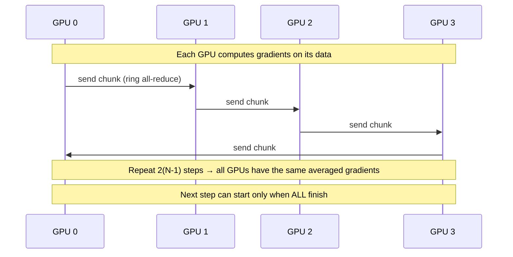
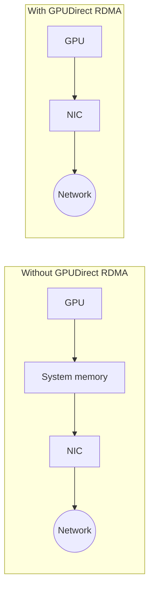
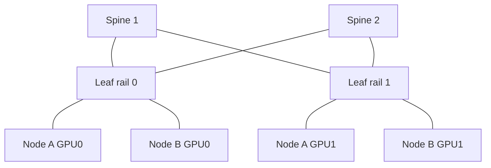

# 2.7 — Networking Requirements for AI Workloads

> **Blueprint:** "Determine networking requirements for AI workloads."

## 1. Key idea

Distributed training is a **team of GPUs**. After each step, all GPUs exchange gradients (**all-reduce**). The step finishes only when the **slowest** GPU finishes. So the network must give:

1. **High bandwidth** (400–800 Gb/s per GPU)
2. **Low latency**
3. **Lossless** delivery (no dropped packets)
4. **Low tail latency** and good congestion control
5. **Non-blocking** topology

## 2. Traffic types

| Traffic | Direction | Example | Requirement |
|---|---|---|---|
| GPU-to-GPU in a node | Scale-up | Tensor parallel | NVLink/NVSwitch (900 GB/s – 1.8 TB/s per GPU) |
| GPU-to-GPU between nodes | **East-west** | Gradient all-reduce, pipeline parallel | InfiniBand / RoCE, 400 Gb/s per GPU, RDMA |
| Storage | Mostly east-west | Load data, write checkpoints | High throughput, parallel FS |
| Users / clients | **North-south** | Inference requests, SSH | Standard Ethernet, load balancers, security |
| Management | OOB / in-band | BMC, provisioning | Separate Ethernet |

## 3. Key technologies

| Technology | What it gives |
|---|---|
| **RDMA** (Remote Direct Memory Access) | NIC reads/writes remote memory directly. No CPU copies. Very low latency. |
| **GPUDirect RDMA** | NIC reads/writes **GPU memory** directly. Bypasses CPU and system memory. |
| **NCCL** | Picks the best path (NVLink, PCIe, InfiniBand, RoCE) and algorithm (ring, tree). |
| **SHARP** (InfiniBand) | In-network computing: Quantum switches do part of the all-reduce. Less data on the wire. |
| **Adaptive routing** | Spreads traffic over many paths to avoid hot spots. |
| **Congestion control** | Stops slow-downs when many senders target one receiver. |

## 4. Topology

- **Fat-tree / leaf-spine:** every leaf connects to every spine. Many equal paths.
- **Non-blocking (1:1):** uplink bandwidth = downlink bandwidth. No oversubscription for training fabrics.
- **Rail-optimized:** NIC *n* (GPU *n*) of every node connects to leaf switch *n*. GPUs with the same index are one hop apart.

## 5. Sizing example

- DGX H100: 8 GPUs × 400 Gb/s = **3.2 Tb/s** compute bandwidth per node (= 400 GB/s).
- Remember: **Gb/s ÷ 8 = GB/s**. 400 Gb/s = 50 GB/s.

## 6. Exam traps

- Training needs **east-west**, lossless, RDMA networking. Inference serving mostly needs **north-south**.
- A packet drop in a training fabric causes retransmits → the whole job slows (tail latency).
- Standard TCP/IP Ethernet without RDMA is a poor choice for large training clusters.
- **Oversubscription** is acceptable for user/management networks, not for the compute fabric.

## 7. Self-check

1. Which feature lets a NIC read GPU memory directly? → GPUDirect RDMA
2. Which InfiniBand feature performs reductions inside the switch? → SHARP
3. Convert 800 Gb/s to GB/s. → 100 GB/s
