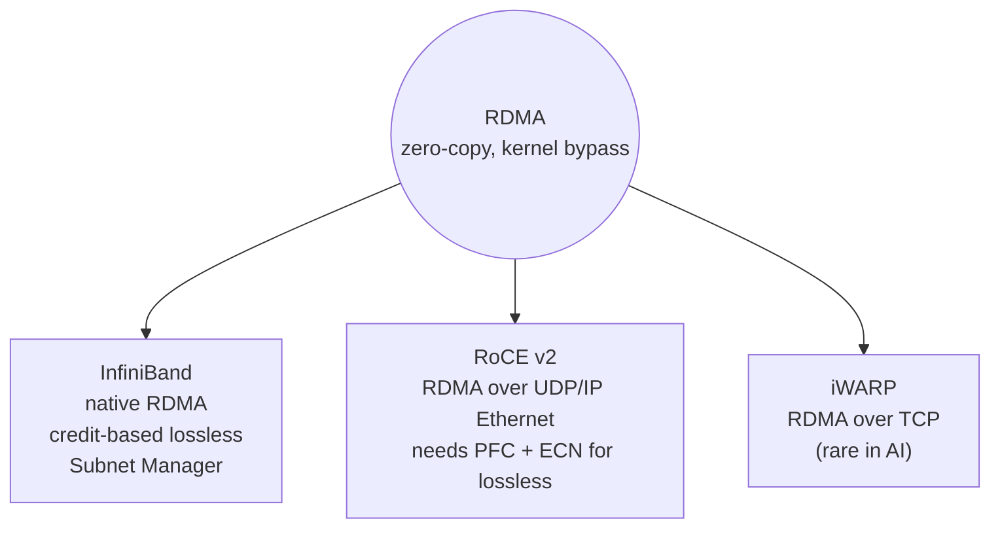

# 2.8 — Data Center Networking Protocols and Key Concepts

> **Blueprint:** "Identify and describe data center networking protocols and key concepts."

## 1. Key idea

Two network families are used for AI: **InfiniBand** and **Ethernet**. Both can carry **RDMA**. Know how each one stays fast and lossless.

## 2. InfiniBand (IB)

| Concept | Meaning |
|---|---|
| **Native RDMA** | Designed for RDMA from the start. |
| **Credit-based flow control** | A sender sends only when the receiver has buffer space. → **Lossless** by design. |
| **Subnet Manager (SM)** | Discovers the fabric, assigns addresses (**LIDs**), computes routes. Runs on a switch, a host (OpenSM), or **UFM**. Every IB fabric needs one active SM. |
| **UFM** (Unified Fabric Manager) | NVIDIA software to manage, monitor, and troubleshoot IB fabrics. |
| **HCA** (Host Channel Adapter) | The IB network card (NVIDIA ConnectX). |
| **SHARP** | In-network reductions in Quantum switches. |
| **Adaptive routing** | Switches pick less congested paths. |
| **Speeds** | EDR 100, **HDR 200**, **NDR 400**, **XDR 800** Gb/s per port. |
| **Partitions (PKeys)** | Isolate traffic, like VLANs. |

## 3. Ethernet for AI

| Concept | Meaning |
|---|---|
| **RoCE v2** | RDMA over Converged Ethernet. Runs over UDP/IP, so it is **routable** across layer 3. |
| **PFC** (Priority Flow Control, IEEE 802.1Qbb) | Pauses a traffic class when buffers fill → prevents drops. |
| **ECN** (Explicit Congestion Notification) | Switch marks packets when congested; sender slows down. |
| **DCQCN** | Congestion control algorithm for RoCE that uses ECN. |
| **Lossless Ethernet** | PFC + ECN configured correctly. RoCE performs badly with drops. |
| **Spectrum-X** | NVIDIA AI Ethernet: Spectrum-4 switches + BlueField-3 SuperNICs, adaptive routing, congestion control, performance isolation. |
| **Speeds** | 100 / 200 / **400** / **800** GbE. |
| **VLAN / VXLAN** | Layer-2 segmentation / overlay networks for multi-tenancy. |
| **BGP / ECMP** | Routing and equal-cost multipath in leaf-spine L3 fabrics. |

## 4. InfiniBand vs Ethernet

| | InfiniBand | Ethernet (RoCE / Spectrum-X) |
|---|---|---|
| Latency | Lowest | Low (with tuning) |
| Lossless | Built-in (credits) | Needs PFC/ECN configuration |
| Management | Subnet Manager / UFM | Standard Ethernet tools, familiar to most teams |
| Ecosystem | HPC and AI training | Enterprise and cloud, multi-tenant |
| Best for | Largest training clusters, highest performance | AI clouds, integration with existing Ethernet |

## 5. Other key concepts

| Term | Meaning |
|---|---|
| **Latency** | Time for one message to arrive (µs). |
| **Bandwidth** | Data per second (Gb/s). |
| **Jitter / tail latency** | Variation in latency. Hurts synchronized training. |
| **MTU** | Maximum packet size. RoCE often uses 4096 B; Ethernet jumbo frames 9000 B. |
| **Leaf-spine** | Two-tier Clos network with equal paths. |
| **Oversubscription ratio** | Downlink ÷ uplink bandwidth. 1:1 = non-blocking. |
| **Layer 2 / Layer 3** | Switching by MAC / routing by IP. |
| **TCP vs UDP** | TCP = reliable, ordered, more overhead. UDP = no handshake; RoCE v2 uses UDP. |

## 6. Exam traps

- "Which component assigns LIDs and computes routes in InfiniBand?" → **Subnet Manager**.
- "RoCE needs what for good performance?" → **Lossless Ethernet (PFC + ECN)**.
- **RoCE v1** is layer 2 only. **RoCE v2** is routable (UDP/IP).
- InfiniBand is lossless by **credit-based flow control**, not by retransmission.

## 7. Self-check

1. Which protocol is RDMA over UDP/IP? → RoCE v2
2. What is the IB speed name for 400 Gb/s? → NDR
3. What does PFC do? → Pauses a specific traffic priority to prevent packet drops
