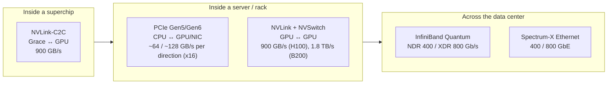
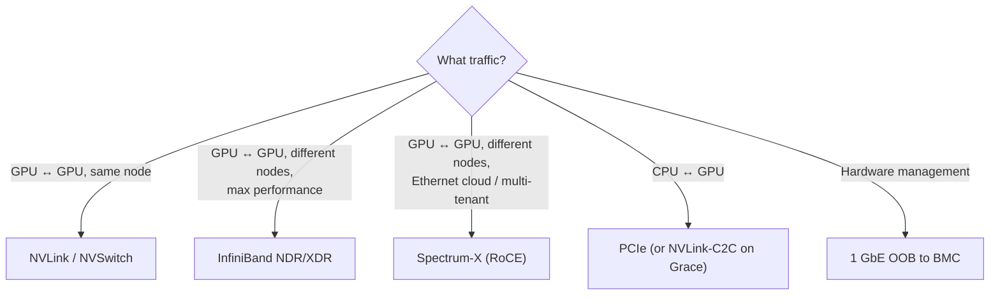

# 2.9 — High-Speed Data Center Network Options and Use Cases

> **Blueprint:** "Identify high-speed data center network options and their use cases."

## 1. Key idea

Match the link to the distance and the traffic:

## 2. Options table

| Option | Scope | Bandwidth | Use case |
|---|---|---|---|
| **PCIe Gen5 x16** | CPU ↔ GPU, CPU ↔ NIC | ~64 GB/s each direction | Standard servers; host-to-device copies |
| **NVLink 4 (Hopper)** | GPU ↔ GPU | 900 GB/s per GPU (18 links) | Multi-GPU training inside DGX/HGX H100 |
| **NVLink 5 (Blackwell)** | GPU ↔ GPU | 1.8 TB/s per GPU | DGX B200, GB200 NVL72 |
| **NVSwitch** | Switch chip for NVLink | All-to-all full bandwidth | Every GPU talks to every GPU at full speed |
| **NVLink Switch System** | NVLink across many nodes/trays | 72 GPUs in one domain (NVL72) | Rack-scale "one giant GPU" |
| **NVLink-C2C** | CPU ↔ GPU in superchip | 900 GB/s | GH200, GB200: coherent memory |
| **H100 NVL bridge** | 2 PCIe GPUs | 600 GB/s | Pair two PCIe GPUs for LLM inference |
| **InfiniBand (Quantum-2 NDR, Quantum-X800 XDR)** | Node ↔ node | 400 / 800 Gb/s per port | Largest training clusters, HPC |
| **Spectrum-X Ethernet** | Node ↔ node | 400 / 800 GbE | AI clouds, multi-tenant, Ethernet shops |
| **Standard Ethernet 10–100 GbE** | Management, users | 10–100 Gb/s | In-band management, north-south |
| **1 GbE** | BMC | 1 Gb/s | Out-of-band management |

## 3. NICs and cables

| Item | Notes |
|---|---|
| **ConnectX-7** | 400 Gb/s NIC, InfiniBand or Ethernet (VPI = can do both) |
| **ConnectX-8 SuperNIC** | 800 Gb/s |
| **BlueField-3 SuperNIC** | 400 Gb/s for Spectrum-X east-west traffic |
| **DAC** (direct attach copper) | Cheap, short (a few meters), in-rack |
| **AOC** (active optical cable) | Longer runs |
| **Transceivers + fiber** | Longest runs, flexible; OSFP and QSFP112 form factors |

## 4. Which network for which job?

## 5. Exam traps

- **NVLink** is faster than **PCIe** by about 7x or more for GPU-to-GPU.
- **NVSwitch** connects NVLinks so all GPUs in a node (or NVL72 rack) have full-bandwidth all-to-all.
- InfiniBand/Ethernet speeds are in **bits** (Gb/s). NVLink is quoted in **bytes** (GB/s).
- **VPI** ConnectX cards can run InfiniBand or Ethernet.

## 6. Self-check

1. Which link connects a Grace CPU to a Hopper GPU in GH200? → NVLink-C2C
2. Which technology gives 72 GPUs one NVLink domain? → NVLink Switch System (GB200 NVL72)
3. Best inter-node fabric for the largest training cluster? → InfiniBand (Quantum NDR/XDR)
