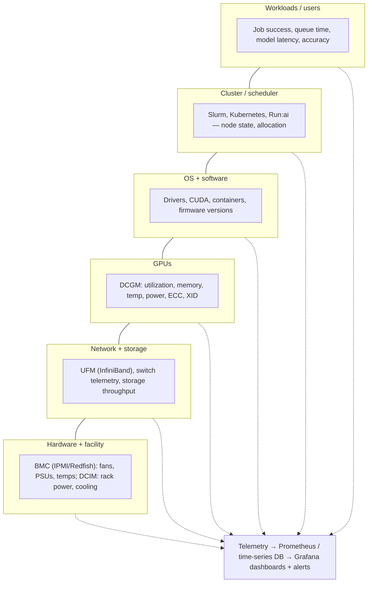
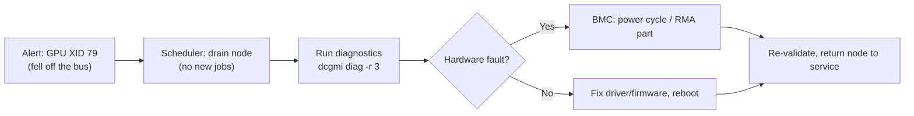

# 3.1 — AI Data Center Management and Monitoring Essentials

> **Blueprint:** "Describe AI data center management and monitoring essentials."
> **Domain 3 — AI Operations (22%)**

## 1. Key idea

Operations has layers. Manage and monitor **every** layer: facility, hardware, network, OS, cluster, workloads.

## 2. Management tools

| Tool | Layer | Purpose |
|---|---|---|
| **BMC** (Baseboard Management Controller) | Hardware | Small computer on the motherboard. Remote power on/off/reset, console (KVM), sensors, firmware updates, event logs. Works when the OS is down. Uses the **out-of-band** network. |
| **IPMI** | Hardware | Older standard protocol to talk to the BMC (`ipmitool`). |
| **Redfish** | Hardware | Modern **RESTful API** (JSON over HTTPS) for BMC management. |
| **DCIM** | Facility | Data Center Infrastructure Management: power, cooling, space, assets. |
| **Base Command Manager** | Cluster | Provision OS images to nodes, configure, monitor, manage Slurm/Kubernetes. |
| **Mission Control** | AI factory | Full-stack operations for DGX deployments: provisioning, workload management, health checks, automated recovery. |
| **UFM** | InfiniBand | Fabric discovery, monitoring, congestion, cable/port errors. |
| **DCGM** | GPU | GPU telemetry, health checks, diagnostics, policies (see 3.3). |
| **Prometheus + Grafana** | All | Collect time-series metrics, dashboards, alerting. |
| **Ansible / Terraform** | Config | Automation and infrastructure as code. |

## 3. Monitoring essentials

| What | Why |
|---|---|
| **Health** (GPU, PSU, fans, NIC links) | Find failing hardware before jobs fail |
| **Utilization** (GPU, CPU, network, storage) | Find waste and bottlenecks |
| **Temperatures and power** | Prevent thermal throttling; stay inside power budget |
| **Errors** (ECC, XID, link errors, IB symbol errors) | Predict failures; drain bad nodes |
| **Firmware/driver versions** | Keep nodes consistent (version drift breaks multi-node jobs) |
| **Logs** (syslog, kernel `dmesg`, scheduler logs) | Root-cause analysis |
| **Alerts** | Notify on-call staff; automate actions (drain node) |

## 4. Typical operations workflow

## 5. Exam traps

- **BMC** = out-of-band, hardware level, works with the OS down. **Redfish** = REST API. **IPMI** = older protocol.
- **DCGM** = GPU monitoring. **UFM** = InfiniBand fabric monitoring.
- Keep **firmware and driver versions consistent** across a cluster.
- Monitoring must include **facility** metrics (power, cooling), not only servers.

## 6. Self-check

1. Which modern API manages servers through the BMC over HTTPS? → Redfish
2. A node is frozen. How do you reboot it remotely? → BMC over the OOB network (IPMI/Redfish/web UI)
3. Which tool monitors InfiniBand port errors across the fabric? → UFM

➡️ Lab: [Lab 05 — GPU monitoring with DCGM Exporter, Prometheus, Grafana](../labs/lab05-dcgm-prometheus-grafana/README.md)
