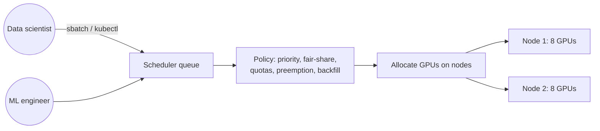
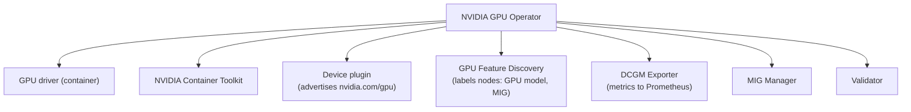

# 3.2 — AI Cluster Orchestration and Job Scheduling

> **Blueprint:** "Describe AI cluster orchestration and job scheduling essentials."

## 1. Key idea

Many users share expensive GPUs. A **scheduler** decides **who runs what, where, and when**. The two main tools are **Slurm** (HPC style, batch jobs) and **Kubernetes** (cloud-native, containers and services).



## 2. Slurm vs Kubernetes

| | **Slurm** | **Kubernetes** |
|---|---|---|
| Origin | HPC / supercomputers | Cloud-native microservices |
| Unit of work | **Job** (batch script) | **Pod** (containers) |
| Best for | Large multi-node training, HPC, MPI | Inference services, pipelines, MLOps, mixed workloads |
| GPU request | `--gres=gpu:8` or `--gpus=8` | `resources.limits: nvidia.com/gpu: 1` |
| Containers | Optional (**Pyxis + Enroot** for NGC containers) | Native |
| Multi-node gang scheduling | Native | Needs extra schedulers (Run:ai, Kueue, Volcano) |
| Long-running services | Not designed for this | Native (Deployments, autoscaling) |
| NVIDIA add-ons | Base Command Manager | **GPU Operator**, **Network Operator**, **Run:ai** |

## 3. Slurm essentials

| Command | Purpose |
|---|---|
| `sbatch job.sh` | Submit a batch job |
| `srun` | Run a job step / interactive job |
| `squeue` | Show the job queue |
| `sinfo` | Show partitions and node states |
| `scancel <id>` | Cancel a job |
| `scontrol show node <n>` | Node details; `scontrol update nodename=<n> state=drain reason="xid"` drains a node |
| `sacct` | Accounting for finished jobs |

Concepts: **partition** (group of nodes = queue), **fair-share** (users with less recent use get priority), **backfill** (small jobs fill gaps without delaying big jobs), **preemption**, **QoS**.

```bash
#!/bin/bash
#SBATCH --job-name=llm-train
#SBATCH --nodes=4
#SBATCH --gpus-per-node=8
#SBATCH --ntasks-per-node=8
#SBATCH --time=24:00:00
#SBATCH --partition=batch
srun --container-image=nvcr.io#nvidia/pytorch:24.10-py3 python train.py
```

## 4. Kubernetes + NVIDIA GPU Operator



- **GPU Operator:** automates every software component a node needs to use GPUs in Kubernetes.
- **Network Operator:** automates RDMA/GPUDirect networking components in Kubernetes.
- **Device plugin:** without it, Kubernetes cannot see GPUs.

```yaml
apiVersion: v1
kind: Pod
metadata: {name: cuda-test}
spec:
  restartPolicy: OnFailure
  containers:
  - name: cuda
    image: nvcr.io/nvidia/k8s/cuda-sample:vectoradd-cuda12.5.0
    resources:
      limits:
        nvidia.com/gpu: 1
```

## 5. Run:ai and GPU sharing

- **Run:ai:** Kubernetes-based GPU orchestration (NVIDIA). Quotas per team, **fractional GPUs**, over-quota borrowing, fair-share, gang scheduling, dashboards.
- Raises cluster **GPU utilization** (typical clusters often run far below full use).

## 6. Containers and MLOps

- **Container:** packages app + libraries; shares host kernel. Lightweight versus a VM.
- **NGC containers:** tested CUDA/framework stacks.
- **MLOps pipelines:** Kubeflow, MLflow on Kubernetes.

## 7. Exam traps

- **Large multi-node batch training** → often Slurm. **Inference microservices** → Kubernetes.
- Kubernetes sees GPUs only through the **device plugin** (installed by the GPU Operator).
- **Backfill** lets small jobs run early without delaying the highest-priority job.
- **Drain** a node to stop new jobs while current jobs finish.

## 8. Self-check

1. Which Slurm command lists node states? → `sinfo`
2. Which resource name requests a GPU in a Kubernetes pod? → `nvidia.com/gpu`
3. Which NVIDIA tool gives fractional GPUs and team quotas on Kubernetes? → Run:ai

➡️ Labs: [Lab 06 — Kubernetes GPU Operator](../labs/lab06-k8s-gpu-operator/README.md) · [Lab 07 — Slurm](../labs/lab07-slurm/README.md)
