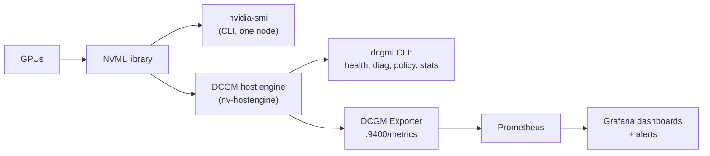
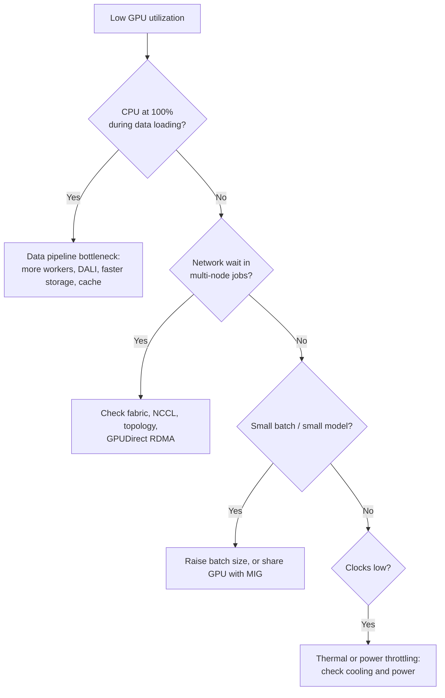

# 3.3 — Key Measures for Monitoring GPUs

> **Blueprint:** "Articulate the key measures and criteria related to monitoring GPUs."

## 1. Key idea

Monitor GPUs for **performance** (are they busy?) and **health** (are they failing?). The main tools are **nvidia-smi** (one node, command line) and **DCGM** (data center scale).



## 2. Key metrics

| Category | Metric | DCGM field (exporter name) | What to look for |
|---|---|---|---|
| Utilization | GPU utilization | `DCGM_FI_DEV_GPU_UTIL` | % of time a kernel runs. **Coarse**: 100% does not mean all SMs are busy |
| Utilization | SM activity | `DCGM_FI_PROF_SM_ACTIVE` | Fraction of SMs busy — better measure |
| Utilization | Tensor Core activity | `DCGM_FI_PROF_PIPE_TENSOR_ACTIVE` | Are Tensor Cores used? (mixed precision on?) |
| Memory | Framebuffer used / free | `DCGM_FI_DEV_FB_USED`, `DCGM_FI_DEV_FB_FREE` | Near full → OOM risk |
| Memory | Memory bandwidth activity | `DCGM_FI_PROF_DRAM_ACTIVE` | Memory-bound workloads |
| Thermal | GPU temperature | `DCGM_FI_DEV_GPU_TEMP` | High temp → **thermal throttling** |
| Thermal | Memory temperature | `DCGM_FI_DEV_MEMORY_TEMP` | HBM heat |
| Power | Power draw | `DCGM_FI_DEV_POWER_USAGE` | Near power limit → **power throttling** |
| Clocks | SM clock | `DCGM_FI_DEV_SM_CLOCK` | Low clocks under load → throttling |
| Clocks | Throttle reasons | `DCGM_FI_DEV_CLOCK_THROTTLE_REASONS` | Thermal, power cap, HW slowdown |
| Errors | ECC single-bit (SBE) | `DCGM_FI_DEV_ECC_SBE_VOL_TOTAL` | Corrected; rising rate = warning |
| Errors | ECC double-bit (DBE) | `DCGM_FI_DEV_ECC_DBE_VOL_TOTAL` | Uncorrectable → app crash; drain node |
| Errors | XID errors | `DCGM_FI_DEV_XID_ERRORS` | Driver-reported GPU error codes |
| Errors | Row remapping | `DCGM_FI_DEV_ROW_REMAP_FAILURE` | Memory repair failed → replace GPU |
| Interconnect | NVLink bandwidth / errors | `DCGM_FI_PROF_NVLINK_TX_BYTES`, NVLink CRC errors | Link problems slow multi-GPU jobs |
| Interconnect | PCIe throughput / replay | `DCGM_FI_PROF_PCIE_TX_BYTES`, `DCGM_FI_DEV_PCIE_REPLAY_COUNTER` | Bad PCIe link |

## 3. Common XID errors (know a few)

| XID | Meaning | Typical action |
|---|---|---|
| 13 | Graphics engine exception | Often application bug; check the code |
| 31 | GPU memory page fault | Often application bug (illegal address) |
| 48 | **Double-bit ECC error** | Uncorrectable memory error; reset GPU, check health |
| 63 / 64 | Row remapping event / failure | Memory repair; 64 = failure → service |
| 74 | **NVLink error** | Check NVLink / NVSwitch hardware |
| 79 | **GPU has fallen off the bus** | Serious hardware/PCIe issue; drain, power cycle, RMA |
| 94 / 95 | Contained / uncontained ECC error | 95 → reset GPU |

## 4. Commands

```bash
nvidia-smi                          # summary: util, memory, temp, power, processes
nvidia-smi -q                       # full details (ECC, clocks, throttle reasons)
nvidia-smi --query-gpu=index,name,utilization.gpu,memory.used,memory.total,temperature.gpu,power.draw --format=csv -l 5
nvidia-smi dmon                     # streaming device metrics
nvidia-smi topo -m                  # topology: NVLink / PCIe paths between GPUs and NICs
nvidia-smi -q -d PERFORMANCE        # clock throttle reasons

dcgmi discovery -l                  # list GPUs
dcgmi health -s a && dcgmi health -c   # enable and check health watches
dcgmi diag -r 1                     # quick diagnostic (seconds)
dcgmi diag -r 2                     # medium (~2 min)
dcgmi diag -r 3                     # long (~30 min) — use before/after maintenance
dcgmi dmon -e 203,252,155           # watch fields (GPU util, FB used, power)
```

## 5. Diagnosing low GPU utilization



## 6. Exam traps

- **GPU utilization %** = time busy, not how much of the GPU is used. Use **SM activity** for depth.
- **SBE** are corrected; **DBE** are not corrected.
- **XID 79** = fell off the bus = serious.
- High temperature + low clocks = **thermal throttling**.
- DCGM Exporter default port: **9400**.

## 7. Self-check

1. Which DCGM diag level is the longest for deep validation? → `-r 3` (level 4 exists for extended tests)
2. Which XID means NVLink error? → 74
3. GPU util shows 100% but training is slow. Which metric gives a better picture? → SM activity / Tensor Core activity

➡️ Labs: [Lab 02 — nvidia-smi and XID analysis](../labs/lab02-nvidia-smi-analysis/README.md) · [Lab 05 — DCGM + Prometheus + Grafana](../labs/lab05-dcgm-prometheus-grafana/README.md)
