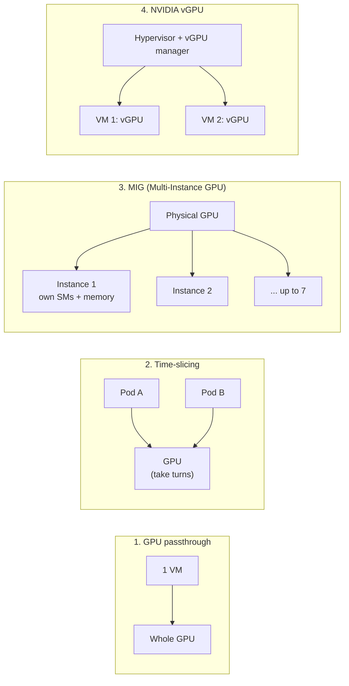

# 3.4 — Virtualizing Accelerated Infrastructure

> **Blueprint:** "Identify the key considerations for virtualizing accelerated infrastructure."

## 1. Key idea

One big GPU is often too much for one small job. You can **share** a GPU in four ways. Each way gives a different level of **isolation** and **performance**.



## 2. Comparison

| Method | Isolation | Memory isolation | Fault isolation | Needs hypervisor | Typical use |
|---|---|---|---|---|---|
| **Passthrough** (PCIe/VFIO) | Full (one VM owns GPU) | Yes | Yes | Yes | One VM needs the full GPU |
| **Time-slicing** | **None** (shared context switching) | **No** | No | No (Kubernetes/CUDA) | Dev/test, light inference, oversubscription |
| **MPS** (Multi-Process Service) | Low | Limited | No | No | Many small CUDA processes run concurrently |
| **MIG** | **Hardware** | **Yes** (dedicated memory, cache, SMs) | **Yes** | No (bare metal or with vGPU) | Guaranteed QoS for multiple inference/dev jobs |
| **vGPU** | Hypervisor-level | Yes (each vGPU gets a framebuffer slice) | Partial (time-sliced) or full (MIG-backed vGPU) | **Yes** (VMware, KVM, etc.) + **license** | VDI, multi-tenant VMs, enterprise virtualization |

## 3. MIG details

- Available on **A100, A30, H100, H200, B200** (data center GPUs; not L40S/L4).
- Up to **7 GPU instances** per GPU.
- Each instance has its **own SMs, L2 cache slice, memory, and memory bandwidth** → predictable performance.
- Profile name format: **`<compute slices>g.<memory>gb`**.

| H100 80 GB profiles | Max instances |
|---|---|
| `1g.10gb` | 7 |
| `1g.20gb` | 4 |
| `2g.20gb` | 3 |
| `3g.40gb` | 2 |
| `4g.40gb` | 1 |
| `7g.80gb` | 1 |

| A100 40 GB profiles | Max instances |
|---|---|
| `1g.5gb` | 7 |
| `2g.10gb` | 3 |
| `3g.20gb` | 2 |
| `4g.20gb` | 1 |
| `7g.40gb` | 1 |

```bash
sudo nvidia-smi -i 0 -mig 1           # enable MIG mode on GPU 0 (needs GPU reset)
sudo nvidia-smi mig -lgip             # list GPU instance profiles
sudo nvidia-smi mig -cgi 9,9 -C       # create two 3g instances (profile ID 9) + compute instances
nvidia-smi -L                         # list GPUs and MIG devices (MIG UUIDs)
sudo nvidia-smi mig -dci && sudo nvidia-smi mig -dgi   # delete instances
```

In Kubernetes, the **GPU Operator's MIG Manager** applies MIG layouts from node labels. Pods request e.g. `nvidia.com/mig-1g.10gb: 1`.

## 4. vGPU details

- **NVIDIA vGPU software** runs in the hypervisor and gives VMs virtual GPUs.
- Needs a **license server** (NVIDIA License System). Compute workloads are licensed through **NVIDIA AI Enterprise**; graphics/VDI through vPC/RTX vWS.
- Supports **live migration** of VMs on supported hypervisors.
- Overhead is small but not zero.

## 5. Key considerations (what the exam asks)

| Consideration | Question to ask |
|---|---|
| **Isolation / QoS** | Do tenants need guaranteed performance? → MIG |
| **Security / multi-tenancy** | Separate customers? → MIG or vGPU/passthrough, not time-slicing |
| **Utilization** | Many small jobs waste a big GPU → share it |
| **Performance overhead** | Bare metal is fastest; virtualization adds small overhead |
| **Licensing** | vGPU needs licenses |
| **Hardware support** | MIG only on certain GPUs; vGPU needs supported GPU + hypervisor |
| **Management** | Live migration, snapshots (VMs) vs simplicity (containers) |
| **Workload size** | Large training uses whole GPUs/nodes, not slices |

## 6. Exam traps

- **Time-slicing has no memory isolation.** One process can use all memory and crash others.
- **MIG = hardware partitioning** with guaranteed resources. Max **7** instances.
- MIG needs **MIG mode enabled** and a GPU reset.
- vGPU needs a **hypervisor** and a **license**.

## 7. Self-check

1. Max MIG instances on an H100? → 7
2. Which sharing method gives no memory isolation? → Time-slicing
3. Two customers must share one GPU with guaranteed memory and performance. Best choice? → MIG
4. What does `3g.40gb` mean? → 3 compute slices, 40 GB memory

➡️ Lab: [Lab 08 — MIG planner](../labs/lab08-mig-planner/README.md)
