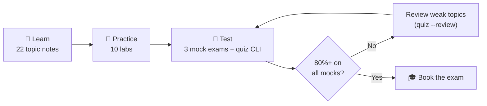

# NCA-AIIO — NVIDIA-Certified Associate: AI Infrastructure and Operations

A complete self-study course to pass the **NCA-AIIO** exam: notes for all 22 blueprint topics, diagrams, 10 hands-on labs, 150 practice questions, and a 4-week plan.



## The exam at a glance

| Item | Detail |
|---|---|
| Exam | NVIDIA-Certified Associate: AI Infrastructure and Operations (NCA-AIIO) |
| Format | 50 multiple-choice questions, 60 minutes, online, remotely proctored (Certiverse) |
| Price | US $125 |
| Pass score | Not published by NVIDIA (aim for 80%+ on practice) |
| Validity | 2 years |
| Prerequisite | Basic understanding of data center infrastructure |
| Official page | https://www.nvidia.com/en-us/learn/certification/ai-infrastructure-operations-associate/ |

| Domain | Weight | ≈ Questions | Notes |
|---|---|---|---|
| 1. Essential AI Knowledge | **38%** | ~19 | [01-essential-ai-knowledge](01-essential-ai-knowledge/) |
| 2. AI Infrastructure | **40%** | ~20 | [02-ai-infrastructure](02-ai-infrastructure/) |
| 3. AI Operations | **22%** | ~11 | [03-ai-operations](03-ai-operations/) |

Always re-check the official page before you book. NVIDIA can update the blueprint.

## Start here

1. Read [00-exam-overview](00-exam-overview/README.md) (10 minutes).
2. Follow [STUDY-PLAN.md](STUDY-PLAN.md) (4 weeks, ~1–1.5 hours per day).
3. Watch the [video explainer](video/nca-aiio-overview.mp4) (3 minutes) for the big picture.
4. Keep [CHEATSHEET.md](CHEATSHEET.md) and [GLOSSARY.md](GLOSSARY.md) open while you study.

## Repository map

```
nca-aiio/
├── 00-exam-overview/          exam facts, blueprint, strategy
├── 01-essential-ai-knowledge/ topics 1.1 – 1.8
├── 02-ai-infrastructure/      topics 2.1 – 2.10
├── 03-ai-operations/          topics 3.1 – 3.4
├── labs/                      10 hands-on labs (most run free, no GPU needed)
├── practice/
│   ├── bank/                  150 questions (JSON), weighted like the exam
│   ├── quiz.py                interactive, timed quiz with weak-topic report
│   └── mock-exam-{1,2,3}.md   printable mock exams with answer keys
├── video/                     overview video explainer
├── STUDY-PLAN.md              4-week day-by-day plan
├── CHEATSHEET.md              all numbers and "X → product" mappings on 2 pages
├── GLOSSARY.md                terms A–Z
└── FLASHCARDS.md              quick recall cards
```

## Labs

| # | Lab | Topics | Needs |
|---|---|---|---|
| 01 | [CPU vs GPU benchmark](labs/lab01-cpu-vs-gpu/) | 1.8, 1.2 | Free Colab T4 |
| 02 | [nvidia-smi and XID analysis](labs/lab02-nvidia-smi-analysis/) | 3.3, 3.1 | Nothing (sample data) |
| 03 | [NGC containers, TensorRT, Triton](labs/lab03-ngc-containers/) | 1.1, 1.7, 1.2 | Cloud GPU VM (~2 h) |
| 04 | [Sizing calculator: memory, power, PUE](labs/lab04-sizing-calculator/) | 2.1, 2.2, 2.3, 2.6 | Python |
| 05 | [DCGM → Prometheus → Grafana](labs/lab05-dcgm-prometheus-grafana/) | 3.1, 3.3 | Docker (GPU simulator included) |
| 06 | [Kubernetes GPU Operator](labs/lab06-k8s-gpu-operator/) | 3.2, 3.4 | Cloud GPU VM (~2 h) |
| 07 | [Slurm scheduling](labs/lab07-slurm/) | 3.2 | Docker |
| 08 | [MIG planner](labs/lab08-mig-planner/) | 3.4 | Python |
| 09 | [Network calculator](labs/lab09-network-calculator/) | 2.7, 2.8, 2.9 | Python |
| 10 | [Operations scenario drills](labs/lab10-ops-scenarios/) | Domain 3 | Nothing |

## Practice

```bash
cd practice
python quiz.py --exam 1        # timed mock exam
python quiz.py --random 50     # new random weighted exam
python quiz.py --topic 2.8     # drill one topic
python quiz.py --review        # retry what you missed
```

## Official resources

- Course: *AI Infrastructure and Operations Fundamentals* (NVIDIA Academy / DLI, self-paced, ~7 hours)
- Exam study guide (PDF) on the official certification page
- NVIDIA DGX SuperPOD reference architecture: https://docs.nvidia.com/dgx-superpod/
- DCGM docs: https://docs.nvidia.com/datacenter/dcgm/latest/
- GPU Operator docs: https://docs.nvidia.com/datacenter/cloud-native/gpu-operator/latest/
- MIG user guide: https://docs.nvidia.com/datacenter/tesla/mig-user-guide/

> Notes are written in simplified technical English (ASD-STE100 style): short sentences, one idea per sentence, active voice.
