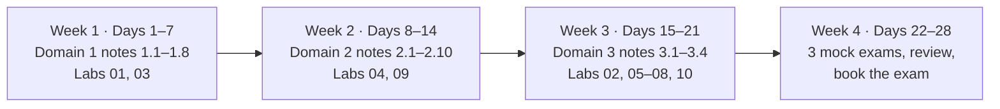

# 4-Week Study Plan (~1–1.5 hours per day)

Weight your time like the exam: **Domain 2 (40%) and Domain 1 (38%)** first, **Domain 3 (22%)** after.

## Daily routine

1. Read the note for the day (30–40 min). Draw the main diagram from memory.
2. Do the "Self-check" questions at the end of the note.
3. Do the lab of the day if there is one.
4. Run `python practice/quiz.py --topic <topic>` for each topic of the day.
5. Write 3 facts you learned in your own words.

## Week 1 — Essential AI Knowledge (38%)

| Day | Study | Lab / practice |
|---|---|---|
| 1 | [1.3 AI vs ML vs DL](01-essential-ai-knowledge/1.3-ai-ml-dl.md), [1.4 Adoption factors](01-essential-ai-knowledge/1.4-ai-adoption-factors.md) | quiz `--topic 1.3`, `--topic 1.4` |
| 2 | [1.8 GPU vs CPU](01-essential-ai-knowledge/1.8-gpu-vs-cpu.md) | [Lab 01](labs/lab01-cpu-vs-gpu/) |
| 3 | [1.2 Training vs inference](01-essential-ai-knowledge/1.2-training-vs-inference.md) | Lab 04 `memory` exercises |
| 4 | [1.1 Software stack](01-essential-ai-knowledge/1.1-nvidia-software-stack.md) | quiz `--topic 1.1` |
| 5 | [1.7 Life-cycle software](01-essential-ai-knowledge/1.7-ai-lifecycle-software.md) | [Lab 03](labs/lab03-ngc-containers/) (weekend if you need a cloud GPU) |
| 6 | [1.6 NVIDIA solutions](01-essential-ai-knowledge/1.6-nvidia-solutions.md), [1.5 Use cases](01-essential-ai-knowledge/1.5-ai-use-cases-industries.md) | quiz `--topic 1.5`, `--topic 1.6` |
| 7 | Review Domain 1, [FLASHCARDS](FLASHCARDS.md) Domain 1 | `quiz.py --domain 1` → target 80% |

## Week 2 — AI Infrastructure (40%)

| Day | Study | Lab / practice |
|---|---|---|
| 8 | [2.1 Hardware for training](02-ai-infrastructure/2.1-hardware-for-training-use-cases.md) | Lab 04 `memory` |
| 9 | [2.2 Scaling](02-ai-infrastructure/2.2-scaling-gpu-infrastructure.md), [2.5 Cluster components](02-ai-infrastructure/2.5-cluster-components.md) | Lab 04 `cluster` |
| 10 | [2.3 Power and cooling](02-ai-infrastructure/2.3-power-and-cooling.md), [2.6 Facility](02-ai-infrastructure/2.6-facility-requirements.md) | Lab 04 `pue`, `cooling` |
| 11 | [2.4 On-prem vs cloud](02-ai-infrastructure/2.4-on-prem-vs-cloud.md) | quiz `--topic 2.4` |
| 12 | [2.7 Networking requirements](02-ai-infrastructure/2.7-networking-requirements-ai.md), [2.9 Network options](02-ai-infrastructure/2.9-high-speed-network-options.md) | [Lab 09](labs/lab09-network-calculator/) |
| 13 | [2.8 Protocols](02-ai-infrastructure/2.8-networking-protocols.md), [2.10 DPU](02-ai-infrastructure/2.10-dpu.md) | quiz `--topic 2.8`, `--topic 2.10` |
| 14 | Review Domain 2 + flashcards | `quiz.py --domain 2` → target 80% |

## Week 3 — AI Operations (22%)

| Day | Study | Lab / practice |
|---|---|---|
| 15 | [3.1 Management and monitoring](03-ai-operations/3.1-dc-management-monitoring.md) | [Lab 02](labs/lab02-nvidia-smi-analysis/) |
| 16 | [3.3 GPU monitoring](03-ai-operations/3.3-gpu-monitoring.md) | [Lab 05](labs/lab05-dcgm-prometheus-grafana/) |
| 17 | [3.2 Orchestration](03-ai-operations/3.2-orchestration-scheduling.md) | [Lab 07 Slurm](labs/lab07-slurm/) |
| 18 | 3.2 continued | [Lab 06 GPU Operator](labs/lab06-k8s-gpu-operator/) (cloud GPU) |
| 19 | [3.4 Virtualization](03-ai-operations/3.4-virtualization.md) | [Lab 08 MIG](labs/lab08-mig-planner/) |
| 20 | All Domain 3 | [Lab 10 scenarios](labs/lab10-ops-scenarios/) |
| 21 | Review Domain 3 | `quiz.py --domain 3` → target 80% |

## Week 4 — Exam readiness

| Day | Task |
|---|---|
| 22 | [Mock exam 1](practice/mock-exam-1.md) (timed). Review every wrong answer. |
| 23 | Re-read notes for weak topics. `quiz.py --review` |
| 24 | [Mock exam 2](practice/mock-exam-2.md) (timed). Review. |
| 25 | [CHEATSHEET](CHEATSHEET.md) from memory: write all numbers on paper. |
| 26 | [Mock exam 3](practice/mock-exam-3.md) (timed). Review. |
| 27 | `quiz.py --random 50` twice. Watch the video again. Book the exam if 80%+. |
| 28 | Light review of flashcards. Rest. |

**Optional:** take the official NVIDIA course *AI Infrastructure and Operations Fundamentals* (~7 hours) in parallel during weeks 1–3.
