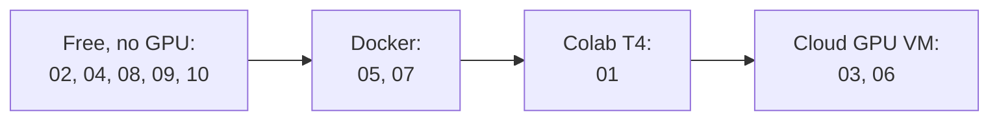

# Labs

| # | Lab | Blueprint | Needs |
|---|---|---|---|
| 01 | [CPU vs GPU benchmark](lab01-cpu-vs-gpu/) | 1.8, 1.2 | Free Colab T4 |
| 02 | [nvidia-smi and XID analysis](lab02-nvidia-smi-analysis/) | 3.3, 3.1 | Nothing (sample data) |
| 03 | [NGC containers, TensorRT, Triton](lab03-ngc-containers/) | 1.1, 1.7, 1.2 | Cloud GPU VM |
| 04 | [Sizing calculator](lab04-sizing-calculator/) | 2.1, 2.2, 2.3, 2.6 | Python |
| 05 | [DCGM → Prometheus → Grafana](lab05-dcgm-prometheus-grafana/) | 3.1, 3.3 | Docker |
| 06 | [Kubernetes GPU Operator](lab06-k8s-gpu-operator/) | 3.2, 3.4 | Cloud GPU VM |
| 07 | [Slurm scheduling](lab07-slurm/) | 3.2 | Docker |
| 08 | [MIG planner](lab08-mig-planner/) | 3.4 | Python |
| 09 | [Network calculator](lab09-network-calculator/) | 2.7–2.9 | Python |
| 10 | [Operations scenarios](lab10-ops-scenarios/) | Domain 3 | Nothing |

Cloud GPU labs (03, 06): stop the VM when you finish. Do labs 03 and 06 on the same day to use one VM.

