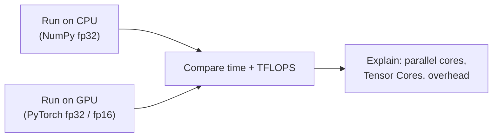

# Lab 01 — CPU vs GPU Benchmark

**Blueprint links:** 1.8 (GPU vs CPU), 1.2 (precision), 1.4 (why GPUs drove AI)
**Time:** 20 minutes · **Cost:** free (Google Colab T4)

## Goal

See with your own numbers why GPUs and Tensor Cores accelerate deep learning.



## Steps

1. Open https://colab.research.google.com and create a new notebook.
2. Select **Runtime → Change runtime type → T4 GPU**.
3. Run this cell:
   ```bash
   !nvidia-smi
   !git clone https://github.com/gvarun17/nca-aiio.git
   !python nca-aiio/labs/lab01-cpu-vs-gpu/benchmark.py --sizes 512 1024 2048 4096 8192
   ```
4. Record the results in the table below.
5. Answer the questions.

You can also run it on your laptop without a GPU. You get only CPU numbers.

## Record

| N | CPU ms | GPU fp32 ms | GPU fp16 ms | Speedup |
|---|---|---|---|---|
| 512 | | | | |
| 4096 | | | | |
| 8192 | | | | |

## Questions

1. Why does the speedup grow as N grows?
2. Why is fp16 faster than fp32 on the GPU?
3. Why does the script call `torch.cuda.synchronize()` before it reads the clock?
4. Look at `nvidia-smi`. Find: GPU name, memory total, power cap, driver version, CUDA version.

<details><summary>Answers</summary>

1. A big matrix has more independent multiply-adds. The GPU runs thousands of them in parallel. Fixed overhead (kernel launch) is a smaller fraction.
2. fp16 uses **Tensor Cores**, which do matrix multiply-accumulate much faster than CUDA cores in fp32. It also moves half the bytes.
3. GPU calls are **asynchronous**. Without sync, you only time the launch, not the work.
4. The T4 has 16 GB memory and a 70 W power cap.
</details>
