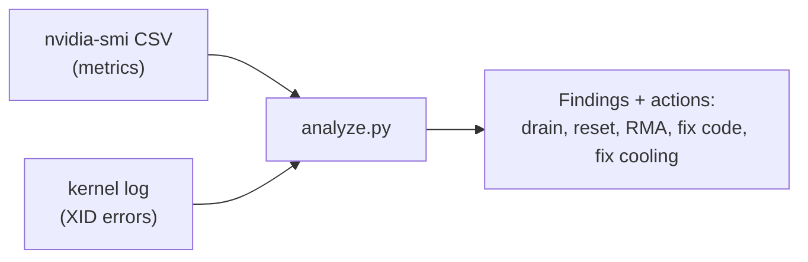

# Lab 02 — Read nvidia-smi and XID Errors Like an Operator

**Blueprint links:** 3.3 (GPU monitoring), 3.1 (operations)
**Time:** 30 minutes · **Cost:** free (works with sample data, no GPU needed)

## Goal

Find throttling, ECC errors, idle GPUs, and XID errors in real-looking telemetry. Decide the correct action for each.



## Part A — Predict first (no script)

Open `sample_gpu_metrics.csv`. For each item, write your diagnosis **before** you run the script:

1. `dgx01` GPU2: temp 88 °C, SM clock 1410 of 1980 MHz.
2. `dgx01` GPU3: power 699.6 of 700 W, SM clock 1590 MHz.
3. `dgx02` GPUs 0–7: utilization ~10%.
4. `dgx02` GPU4: 0% util, 0 MB used, 1 uncorrected ECC error.
5. `dgx02` GPU7: memory 80,950 of 81,559 MB.

Open `sample_kernel.log`. For each XID (13, 48, 94, 63, 74, 79, 31): is it an **application** problem or a **hardware** problem?

## Part B — Run the analyzer

```bash
cd labs/lab02-nvidia-smi-analysis
python analyze.py
```

Compare the output with your predictions.

## Part C — Real GPU (optional, Colab)

```bash
!nvidia-smi
!nvidia-smi -q -d PERFORMANCE,ECC,TEMPERATURE,POWER
!nvidia-smi topo -m
!nvidia-smi --query-gpu=timestamp,index,name,utilization.gpu,memory.used,memory.total,temperature.gpu,power.draw,power.limit,clocks.sm,clocks.max.sm,ecc.errors.uncorrected.volatile.total,ecc.errors.corrected.volatile.total --format=csv,nounits
```

Run Lab 01's benchmark in a second cell while you watch `nvidia-smi dmon -c 20`.

## Answers

<details><summary>Show</summary>

1. **Thermal throttling** → check airflow, fans, inlet temperature, blanking panels.
2. **Power throttling** (at power limit) → expected under heavy load, or check power cap settings.
3. **Low utilization** on the whole node → input pipeline bottleneck, small batch, or a waiting multi-node job. Check CPU, storage, network.
4. Uncorrected ECC + GPU not working → **drain node**, reset GPU, run `dcgmi diag -r 3`, RMA if it repeats.
5. Memory nearly full → **OOM risk**. Lower batch size or use a bigger GPU.

XIDs: 13 and 31 → usually **application**. 48, 63, 74, 79, 94/95 → **hardware / memory / interconnect**. 79 is the most serious.
</details>
