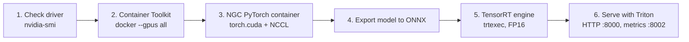

# Lab 03 — NGC Containers, TensorRT, and Triton (the Software Stack in Practice)

**Blueprint links:** 1.1 (software stack), 1.7 (life cycle), 1.2 (inference)
**Time:** 60–90 minutes · **Cost:** a cloud GPU VM for ~1–2 hours (any NVIDIA GPU: T4, L4, A10G)

## Goal

Touch each layer of the stack: **driver → Container Toolkit → NGC container → framework → TensorRT → Triton**.



## Setup

Use any cloud VM image with the NVIDIA driver, Docker, and the NVIDIA Container Toolkit (for example a "Deep Learning" VM image on AWS, GCP, or Azure; GPU: T4/L4/A10G).
Pick NGC tags that match your driver. See the **framework support matrix** on docs.nvidia.com. The tags below are examples. Use the same `YY.MM` for every container.

```bash
export TAG=24.10        # NGC release (YY.MM). Change it to match your driver.
```

## Step 1 — Driver layer

```bash
nvidia-smi                   # driver version, CUDA version (max supported), GPUs
nvidia-smi -L                # list GPUs and UUIDs
```

**Question:** Is the CUDA version in `nvidia-smi` the toolkit version? *(No. It is the maximum CUDA version the driver supports.)*

## Step 2 — Container Toolkit layer

```bash
docker run --rm --gpus all ubuntu nvidia-smi
```

The container has no driver inside. The NVIDIA Container Toolkit mounts the host driver into it.

## Step 3 — NGC framework container

```bash
docker run --rm --gpus all --ipc=host nvcr.io/nvidia/pytorch:${TAG}-py3 \
  python -c "import torch; print(torch.__version__, torch.version.cuda, torch.backends.cudnn.version(), torch.cuda.nccl.version(), torch.cuda.get_device_name(0))"
```

Write down: PyTorch, CUDA, cuDNN, and NCCL versions. One container gives a tested set.

## Step 4 — Export a model to ONNX

```bash
mkdir -p ~/lab03 && cd ~/lab03
docker run --rm --gpus all -v $PWD:/w -w /w nvcr.io/nvidia/pytorch:${TAG}-py3 python -c "
import torch, torchvision
m = torchvision.models.resnet50(weights=None).eval().cuda()
x = torch.randn(1,3,224,224, device='cuda')
torch.onnx.export(m, x, 'resnet50.onnx', input_names=['input'], output_names=['output'],
                  dynamic_axes={'input':{0:'batch'}, 'output':{0:'batch'}})
print('exported')"
```

## Step 5 — Optimize with TensorRT

```bash
docker run --rm --gpus all -v $PWD:/w -w /w nvcr.io/nvidia/tensorrt:${TAG}-py3 \
  trtexec --onnx=resnet50.onnx --saveEngine=resnet50_fp32.plan \
          --minShapes=input:1x3x224x224 --optShapes=input:8x3x224x224 --maxShapes=input:32x3x224x224
docker run --rm --gpus all -v $PWD:/w -w /w nvcr.io/nvidia/tensorrt:${TAG}-py3 \
  trtexec --onnx=resnet50.onnx --saveEngine=resnet50_fp16.plan --fp16 \
          --minShapes=input:1x3x224x224 --optShapes=input:8x3x224x224 --maxShapes=input:32x3x224x224
```

Compare **throughput (qps)** and **latency** in the two outputs. FP16 is faster: it uses Tensor Cores.

## Step 6 — Serve with Triton

```bash
mkdir -p models/resnet50/1
cp resnet50_fp16.plan models/resnet50/1/model.plan
cat > models/resnet50/config.pbtxt <<'EOF'
name: "resnet50"
platform: "tensorrt_plan"
max_batch_size: 32
dynamic_batching { max_queue_delay_microseconds: 2000 }
instance_group [ { count: 1, kind: KIND_GPU } ]
EOF

docker run -d --name triton --gpus all -p8000:8000 -p8001:8001 -p8002:8002 \
  -v $PWD/models:/models nvcr.io/nvidia/tritonserver:${TAG}-py3 \
  tritonserver --model-repository=/models

sleep 20
curl -s localhost:8000/v2/health/ready -o /dev/null -w "%{http_code}\n"   # 200 = ready
curl -s localhost:8000/v2/models/resnet50 | python3 -m json.tool
curl -s localhost:8002/metrics | grep nv_inference_count
```

Load test with the Triton SDK container:

```bash
docker run --rm --net=host nvcr.io/nvidia/tritonserver:${TAG}-py3-sdk \
  perf_analyzer -m resnet50 --concurrency-range 1:8 --shape input:3,224,224
```

**Observe:** as concurrency rises, throughput rises (dynamic batching) and latency rises too. This is the latency/throughput trade-off from section 1.2.

## Clean up

```bash
docker rm -f triton
```

Stop the cloud VM so you do not pay for idle time.

## Questions

1. Which layer must be on the host, and which layers are in the container?
2. What did TensorRT change in the model?
3. What does Triton dynamic batching do?
4. Port numbers: Triton HTTP, gRPC, metrics?
5. How is NIM different from this manual flow?

<details><summary>Answers</summary>

1. Host: **driver** (+ Container Toolkit). Container: CUDA runtime, cuDNN, NCCL, framework, app.
2. Layer/tensor fusion, precision (FP16), kernel auto-tuning for this GPU → an optimized **engine (plan)**. The engine is specific to the GPU model and TensorRT version.
3. It groups requests that arrive close together into one batch → higher throughput and GPU use.
4. 8000 HTTP, 8001 gRPC, 8002 Prometheus metrics.
5. **NIM** packages the model, the optimized engine, and the server with a standard API in one container. You run one command instead of steps 4–6.
</details>
