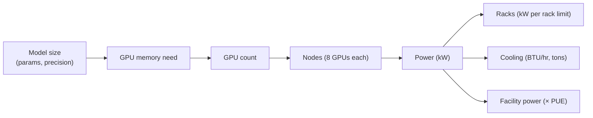

# Lab 04 — Size an AI Cluster: Memory, GPUs, Power, Cooling, PUE

**Blueprint links:** 1.2, 2.1, 2.2, 2.3, 2.6
**Time:** 45 minutes · **Cost:** free (Python only)

## Goal

Practice the arithmetic the exam expects: memory per model, GPUs per job, nodes, racks, kW, BTU/hr, PUE.



## Formulas (learn them)

| Quantity | Formula |
|---|---|
| Inference weights | params × bytes/param (FP16 = 2, FP8 = 1, FP4 = 0.5) |
| Training memory | params × ~16 bytes + activations |
| Nodes | ceil(GPUs ÷ 8) |
| Power | nodes × kW per node |
| Heat | kW × 3,412 = BTU/hr |
| Cooling tons | kW ÷ 3.517 |
| PUE | facility kW ÷ IT kW |
| Scaling efficiency | measured speedup ÷ GPU count |

## Exercises

Do each by hand first. Then check with the script.

```bash
cd labs/lab04-sizing-calculator
python sizing.py memory --params 7 --mode infer --precision fp16
python sizing.py memory --params 70 --mode infer --precision fp8
python sizing.py memory --params 70 --mode train
python sizing.py cluster --gpus 256 --system dgx-h100 --rack-kw 40
python sizing.py cluster --gpus 256 --system dgx-h100 --rack-kw 20
python sizing.py cluster --gpus 1024 --system dgx-b200 --rack-kw 60
python sizing.py pue --facility-kw 1300 --it-kw 1000
python sizing.py cooling --kw 41
```

1. A 13B model at FP16. Weights only: how many GB? Fits one L40S (48 GB)?
2. A 70B model at FP8 for inference. Minimum number of H100 80 GB GPUs?
3. 256 GPUs on DGX H100 with a 40 kW rack limit. How many racks? With a 20 kW limit?
4. How many SuperPOD scalable units is 256 GPUs?
5. Facility 2,400 kW, IT 2,000 kW. PUE?
6. 8 GPUs give 6.8x speedup over 1 GPU. Scaling efficiency?

<details><summary>Answers</summary>

1. 13 × 2 = 26 GB → yes, fits (with room for KV cache).
2. 70 GB weights + ~20% → ~84 GB → **2** H100s.
3. 32 nodes. 40 kW → 3 per rack → **11 racks**. 20 kW → 1 per rack → **32 racks**.
4. 32 nodes = **1 SU**.
5. **1.2**.
6. 6.8 / 8 = **85%**.
</details>
