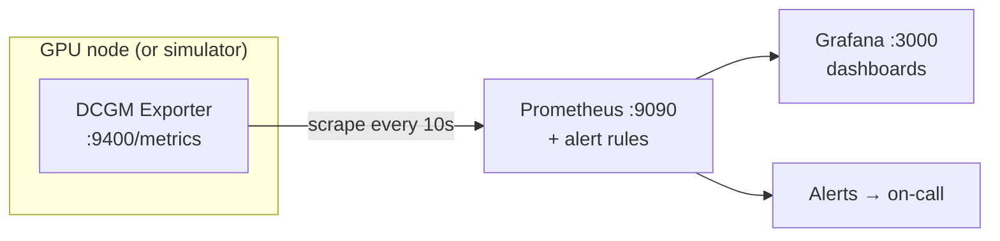

# Lab 05 — GPU Monitoring: DCGM Exporter → Prometheus → Grafana

**Blueprint links:** 3.1 (management and monitoring), 3.3 (GPU metrics)
**Time:** 60 minutes · **Cost:** free (no GPU needed: a simulator is included)

## Goal

Build the standard GPU observability pipeline. Write PromQL queries and alerts. Find a hot GPU, an idle GPU, and a failing GPU.



## Option A — No GPU (laptop with Docker)

1. Start the simulator (terminal 1):
   ```bash
   cd labs/lab05-dcgm-prometheus-grafana
   python fake_dcgm_exporter.py
   ```
2. Check it (terminal 2):
   ```bash
   curl -s localhost:9400/metrics | grep GPU_TEMP
   ```
3. Start Prometheus and Grafana:
   ```bash
   docker compose up -d
   ```
4. Open http://localhost:9090 → **Status → Targets**. The `host.docker.internal:9400` target must be **UP**. (The `dcgm-exporter` target is DOWN in this option. That is expected.)

## Option B — Real GPU host

Use a cloud VM with an NVIDIA GPU, the driver, Docker, and the NVIDIA Container Toolkit.

```bash
docker compose -f docker-compose.yml -f docker-compose.gpu.yml up -d
curl -s localhost:9400/metrics | head -40
```

In Kubernetes, the **GPU Operator** installs DCGM Exporter for you (Lab 06).

## Tasks

Run each query in Prometheus (**Graph** tab). Write down what you see.

| # | Question | PromQL |
|---|---|---|
| 1 | Utilization of every GPU | `DCGM_FI_DEV_GPU_UTIL` |
| 2 | Average utilization per node | `avg by (Hostname) (DCGM_FI_DEV_GPU_UTIL)` |
| 3 | Which GPU is hottest? | `topk(1, DCGM_FI_DEV_GPU_TEMP)` |
| 4 | Find thermal throttling | `DCGM_FI_DEV_GPU_TEMP > 85 and DCGM_FI_DEV_SM_CLOCK < 1600` |
| 5 | Idle GPUs | `DCGM_FI_DEV_GPU_UTIL < 20` |
| 6 | Memory used % | `DCGM_FI_DEV_FB_USED / (DCGM_FI_DEV_FB_USED + DCGM_FI_DEV_FB_FREE) * 100` |
| 7 | Total node power (W) | `sum by (Hostname) (DCGM_FI_DEV_POWER_USAGE)` |
| 8 | Real busy-ness vs "util" | `DCGM_FI_PROF_SM_ACTIVE` vs `DCGM_FI_DEV_GPU_UTIL / 100` |
| 9 | Rising ECC errors | `increase(DCGM_FI_DEV_ECC_SBE_VOL_TOTAL[5m])` |
| 10 | Any XID | `DCGM_FI_DEV_XID_ERRORS > 0` (wait 2+ minutes) |

Then open **Alerts** in Prometheus. Wait for `GPUThermalThrottleSuspected` and `GPUXidError` to fire.

### Grafana

1. Open http://localhost:3000.
2. **Connections → Data sources → Add → Prometheus**. URL: `http://prometheus:9090`. Save.
3. **Dashboards → New → Import**. Enter dashboard ID **12239** (NVIDIA DCGM Exporter Dashboard). Select the Prometheus source.

## Questions

1. Which simulated GPU throttles? How did you prove it?
2. Why is `DCGM_FI_PROF_SM_ACTIVE` a better utilization signal than `DCGM_FI_DEV_GPU_UTIL`?
3. GPU 6 shows XID 48. What do you do with the node?
4. Which port does DCGM Exporter use by default?

<details><summary>Answers</summary>

1. GPU 2: temp > 85 °C **and** SM clock ~1350 MHz (max 1980).
2. GPU_UTIL only says a kernel was running during the sample period. SM_ACTIVE says what fraction of the SMs were busy.
3. XID 48 = uncorrectable (double-bit) ECC. Drain the node in the scheduler, reset the GPU, run `dcgmi diag -r 3`, RMA if it repeats.
4. 9400.
</details>

## Clean up

```bash
docker compose down
```
