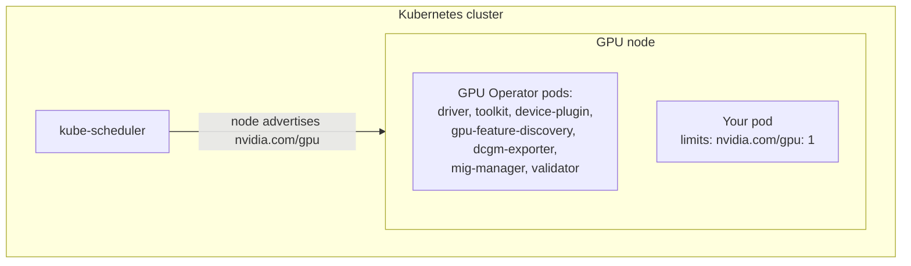

# Lab 06 — Kubernetes with the NVIDIA GPU Operator

**Blueprint links:** 3.2 (orchestration), 3.3 (monitoring), 3.4 (time-slicing, MIG)
**Time:** 90 minutes · **Cost:** one GPU node for ~2 hours (cloud VM with any NVIDIA GPU)

## Goal

Install the GPU Operator. Run GPU pods. Turn on time-slicing. Read DCGM metrics. (MIG part needs an A100/H100.)



## Setup (single-node, simplest)

Use an Ubuntu 22.04/24.04 GPU VM. You do **not** need to install the NVIDIA driver; the Operator does it. (If your image already has a driver, add `--set driver.enabled=false`.)

```bash
# k3s = small Kubernetes
curl -sfL https://get.k3s.io | sh -
sudo cp /etc/rancher/k3s/k3s.yaml ~/.kube/config 2>/dev/null || (mkdir -p ~/.kube && sudo cp /etc/rancher/k3s/k3s.yaml ~/.kube/config)
sudo chown $USER ~/.kube/config
curl -fsSL https://raw.githubusercontent.com/helm/helm/main/scripts/get-helm-3 | bash
```

## Step 1 — Install the GPU Operator

```bash
helm repo add nvidia https://helm.ngc.nvidia.com/nvidia && helm repo update
helm install gpu-operator nvidia/gpu-operator -n gpu-operator --create-namespace --wait
# k3s uses its own containerd; if the toolkit pod fails, see the GPU Operator docs section for k3s/containerd settings.
kubectl get pods -n gpu-operator
```

Wait until all pods are `Running` or `Completed`. Then:

```bash
kubectl describe node | grep -A3 "nvidia.com/gpu"
kubectl get node -o json | jq '.items[0].metadata.labels | with_entries(select(.key|startswith("nvidia.com")))'
```

**Find:** `nvidia.com/gpu: 1` under Capacity, and labels such as `nvidia.com/gpu.product`. (Labels come from **GPU Feature Discovery**.)

## Step 2 — Run a GPU pod

```bash
kubectl apply -f manifests/cuda-vectoradd.yaml
kubectl logs pod/cuda-vectoradd     # "Test PASSED"
```

## Step 3 — Prove the scheduler counts GPUs

```bash
kubectl apply -f manifests/two-gpu-pods.yaml
kubectl get pods                    # one pod Running, one Pending (only 1 GPU)
kubectl describe pod gpu-pod-b | grep -A3 Events   # "Insufficient nvidia.com/gpu"
kubectl delete -f manifests/two-gpu-pods.yaml
```

## Step 4 — Time-slicing (share one GPU)

```bash
kubectl apply -f manifests/time-slicing-config.yaml
kubectl patch clusterpolicies.nvidia.com/cluster-policy -n gpu-operator --type merge \
  -p '{"spec":{"devicePlugin":{"config":{"name":"time-slicing-config","default":"any"}}}}'
sleep 60
kubectl describe node | grep "nvidia.com/gpu:"      # now shows 4
kubectl apply -f manifests/two-gpu-pods.yaml
kubectl get pods                                    # both Running on one GPU
```

**Important:** time-slicing has **no memory isolation** and **no fault isolation**.

## Step 5 — DCGM metrics

```bash
kubectl -n gpu-operator port-forward svc/nvidia-dcgm-exporter 9400:9400 &
curl -s localhost:9400/metrics | grep -E "DCGM_FI_DEV_GPU_UTIL|DCGM_FI_DEV_FB_USED" | head
```

## Step 6 (optional, A100/H100 only) — MIG

First set the MIG strategy to `mixed`, so each profile has its own resource name (`nvidia.com/mig-1g.10gb`). With the default `single` strategy, MIG devices appear as `nvidia.com/gpu`.

```bash
helm upgrade gpu-operator nvidia/gpu-operator -n gpu-operator --reuse-values --set mig.strategy=mixed
kubectl label node $(kubectl get nodes -o name | head -1 | cut -d/ -f2) nvidia.com/mig.config=all-1g.10gb --overwrite
# The MIG Manager reconfigures the GPU. For an A100 40GB use all-1g.5gb.
kubectl describe node | grep "nvidia.com/mig"
kubectl apply -f manifests/mig-pod.yaml
```

## Clean up

```bash
kubectl delete -f manifests/ --ignore-not-found
helm uninstall gpu-operator -n gpu-operator
```

Delete the VM.

## Questions

1. Which GPU Operator component makes `nvidia.com/gpu` visible to Kubernetes?
2. Which component adds GPU model labels to nodes?
3. Why did the second pod stay Pending in Step 3?
4. Time-slicing vs MIG: which one isolates memory?

<details><summary>Answers</summary>

1. The **device plugin**.
2. **GPU Feature Discovery** (GFD).
3. The node had 1 GPU and the first pod requested it. GPUs are integer resources; Kubernetes does not overcommit them by default.
4. **MIG**.
</details>
