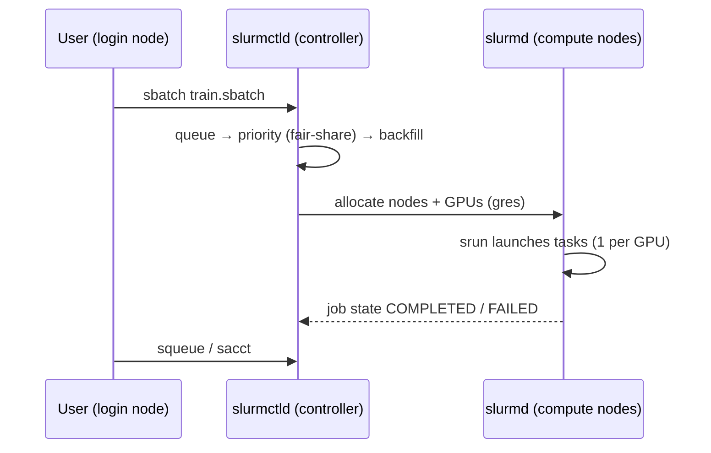

# Lab 07 — Slurm Job Scheduling for GPU Clusters

**Blueprint links:** 3.2 (orchestration and job scheduling), 3.1 (operations)
**Time:** 60 minutes · **Cost:** free (Docker on your laptop; no GPU needed)

## Goal

Use the Slurm commands an AI cluster operator uses every day: submit, watch, cancel, drain, and read job scripts for GPU jobs.



## Setup — a small Slurm cluster in Docker

```bash
git clone https://github.com/giovtorres/slurm-docker-cluster.git
cd slurm-docker-cluster
docker compose up -d        # builds on first run; this takes some minutes
./register_cluster.sh       # if the repo provides it (registers accounting)
docker exec -it slurmctld bash
```

(This cluster has CPU nodes only. GPU flags are explained below; practice them on a real cluster later.)
Copy the scripts in this folder into the container, or type them.

## Part A — Inspect the cluster

```bash
sinfo                         # partitions and node states (idle, alloc, mix, drain, down)
sinfo -N -l                   # one line per node
scontrol show partition
scontrol show node c1
```

## Part B — Submit and manage jobs

```bash
sbatch hello.sbatch
squeue                        # PD = pending, R = running
squeue -u $USER -o "%.8i %.10P %.15j %.2t %.10M %.6D %R"
sacct -j <jobid> --format=JobID,JobName,State,Elapsed,ExitCode
scancel <jobid>
srun -N 2 hostname            # run a command on 2 nodes now
salloc -N 1                   # interactive allocation; type exit to release
```

## Part C — Operator tasks

```bash
# Take a node out of service (running jobs finish, no new jobs start)
scontrol update nodename=c2 state=drain reason="XID 79 - waiting for RMA"
sinfo -R                      # shows the reason
# Return it to service after repair
scontrol update nodename=c2 state=resume
# Hold and release a job
scontrol hold <jobid> ; scontrol release <jobid>
```

## Part D — Read a real multi-node GPU job

Open [`train-multinode.sbatch`](train-multinode.sbatch). Answer:

1. How many GPUs does the job use in total?
2. Why is `--ntasks-per-node` equal to `--gpus-per-node`?
3. What do `--container-image` and `--container-mounts` need on the cluster?
4. Why is `NCCL_IB_HCA` set?

<details><summary>Answers</summary>

1. 4 nodes × 8 GPUs = **32 GPUs**.
2. One process (rank) per GPU is the standard pattern for PyTorch distributed / NCCL.
3. **Pyxis + Enroot** (Slurm plugins that run NGC containers).
4. It tells NCCL which InfiniBand adapters (HCAs) to use for GPU-to-GPU traffic between nodes.
</details>

## Key scheduling concepts

| Concept | Meaning |
|---|---|
| Partition | A named group of nodes (a queue), e.g. `batch`, `interactive` |
| GRES | Generic resource, e.g. `gpu:8` |
| Fair-share | Users who used less recently get higher priority |
| Backfill | Small jobs run in gaps if they do not delay higher-priority jobs |
| Preemption | High-priority job can stop/requeue a lower one |
| Drain | No new jobs on the node; current jobs finish |
| Gang scheduling | All nodes of a multi-node job start together |
