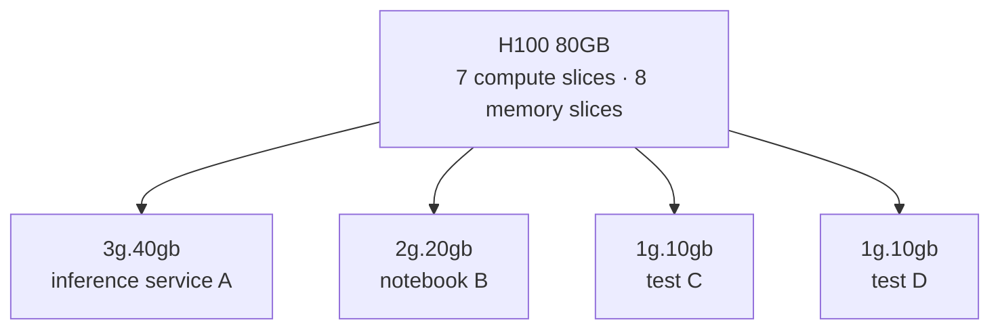

# Lab 08 — Plan GPU Sharing with MIG

**Blueprint links:** 3.4 (virtualization), 2.2 (scaling), 3.3 (utilization)
**Time:** 30 minutes · **Cost:** free (Python). Optional real MIG part needs an A100/H100.

## Goal

Read MIG profile names. Choose profiles for workloads. Count how many GPUs you save. Know when **not** to use MIG.



## Part A — Profiles

```bash
cd labs/lab08-mig-planner
python mig_planner.py --gpu h100-80gb --list
python mig_planner.py --gpu a100-40gb --list
```

1. What does `2g.20gb` mean?
2. Max number of `1g.10gb` instances on an H100 80GB?
3. Max number of `3g.40gb` instances on an H100 80GB?

## Part B — Plan

A team has 6 inference services that need: 8, 8, 12, 30, 35, 70 GB.

```bash
python mig_planner.py --gpu h100-80gb --workloads 8 8 12 30 35 70
```

4. How many H100s do you need with MIG? Without MIG (one GPU each)?
5. Which workload gets a full `7g.80gb`?

## Part C — Decide

For each case, choose: **whole GPU**, **MIG**, **time-slicing**, or **vGPU**.

| Case | Your choice |
|---|---|
| a. Two different customers' inference APIs on one GPU; need guaranteed performance | |
| b. 20 students run small notebooks; cost matters; no strict isolation | |
| c. 70B model training | |
| d. VMware VDI desktops for designers | |
| e. 7 small production models, each < 10 GB, each needs predictable latency | |

## Part D (optional) — Real MIG on A100/H100

```bash
sudo nvidia-smi -i 0 -mig 1                 # enable MIG (stop GPU processes first; may need reset)
sudo nvidia-smi mig -lgip                   # list profiles and free counts
sudo nvidia-smi mig -cgi 3g.40gb,2g.20gb,1g.10gb,1g.10gb -C
nvidia-smi -L                               # MIG devices with UUIDs
CUDA_VISIBLE_DEVICES=MIG-<uuid> python ../lab01-cpu-vs-gpu/benchmark.py
sudo nvidia-smi mig -dci && sudo nvidia-smi mig -dgi
sudo nvidia-smi -i 0 -mig 0
```

<details><summary>Answers</summary>

1. 2 compute slices (of 7), 20 GB memory.
2. 7.
3. 2.
4. With MIG: 3 GPUs (one full 7g.80gb for the 70 GB model; the rest packed onto 2). Without MIG: 6.
5. The 70 GB workload.

Part C: a → **MIG** (hardware isolation, QoS). b → **time-slicing** (cheap, no isolation). c → **whole GPUs** (many, multi-node). d → **vGPU** (hypervisor + license). e → **MIG** (7 × 1g.10gb on one H100).
</details>
