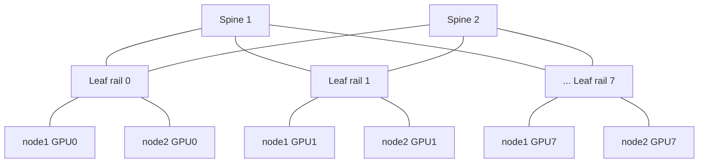

# Lab 09 — AI Network Design Calculator

**Blueprint links:** 2.7, 2.8, 2.9, 2.2
**Time:** 40 minutes · **Cost:** free (Python)

## Goal

Do the network math: bit/byte conversion, all-reduce time, leaf/spine counts, and oversubscription.



## Exercises

```bash
cd labs/lab09-network-calculator
python netcalc.py convert --gbps 400
python netcalc.py allreduce --size-gb 14 --gpus 64 --link-gbps 400
python netcalc.py allreduce --size-gb 14 --gpus 64 --link-gbps 100
python netcalc.py fabric --nodes 32
python netcalc.py fabric --nodes 128
python netcalc.py oversub --down 32 --up 16
```

1. 800 Gb/s = ? GB/s
2. A 7B model in BF16 has 14 GB of gradients. Compare all-reduce time at 400 Gb/s vs 100 Gb/s. What happens to GPU utilization at 100 Gb/s?
3. How many leaf and spine switches for 128 DGX nodes with 64-port switches? Compare with NVIDIA's SuperPOD table (4 SU: 32 leaf, 16 spine).
4. A leaf has 32 ports down and 16 up. Ratio? OK for the compute fabric?

<details><summary>Answers</summary>

1. 100 GB/s.
2. ~0.55 s vs ~2.2 s per step (ideal). At 100 Gb/s GPUs wait for the network → utilization drops.
3. 32 leaf (8 rails × 4), 16 spine. It matches the reference architecture.
4. 2:1 oversubscribed → **not** OK for the GPU compute fabric (use 1:1).
</details>
