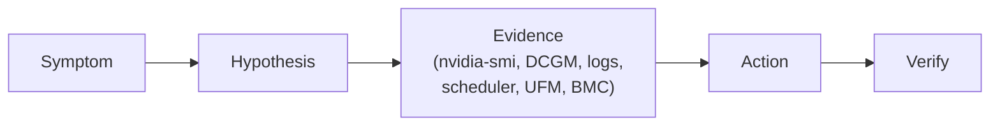

# Lab 10 — Operations Scenario Drills

**Blueprint links:** all of Domain 3, plus 2.3, 2.5, 2.7, 1.2
**Time:** 45 minutes · **Cost:** free

## How to use

1. Read one scenario.
2. Write your answer: **cause → evidence to collect → action**.
3. Open the answer. Score yourself: 2 = correct, 1 = partial, 0 = wrong.
4. Target: 30 of 36 before the exam.

---

### Scenario 1
Multi-node training on 16 DGX nodes is 40% slower than last week. GPU utilization drops to 0 for short periods every step. One node shows InfiniBand symbol errors in UFM.

Answer

Cause: a bad IB cable/transceiver/port on one node slows all-reduce; synchronous training waits for the slowest rank. Evidence: UFM port counters, `ibdiagnet`, NCCL tests (all_reduce_perf). Action: drain that node, replace cable/transceiver, re-run NCCL tests, return to service.

### Scenario 2
`nvidia-smi` shows one GPU at 87 °C with SM clock 1,400 MHz; the other GPUs are at 65 °C and 1,980 MHz.

Answer

Thermal throttling on one GPU. Check airflow, fans (BMC sensors), blanking panels, inlet temperature, rack hot spots. Check `nvidia-smi -q -d PERFORMANCE` for the throttle reason.

### Scenario 3
`dmesg` shows `Xid 79: GPU has fallen off the bus`. The node runs jobs that fail.

Answer

Serious hardware/PCIe/power fault. Drain the node in the scheduler, collect logs (`nvidia-bug-report.sh`), power-cycle through the BMC, run `dcgmi diag -r 3`, open RMA if it repeats.

### Scenario 4
A data science team says "GPUs are slow". DCGM shows GPU util 25%, CPU at 100%, storage reads low.

Answer

Input pipeline bottleneck (CPU-bound data loading/decoding). Use more data loader workers, DALI for GPU decoding/augmentation, cache data on local NVMe, preprocess offline.

### Scenario 5
Ten developers each hold a full H100 for notebooks but use ~5 GB of memory and ~5% compute.

Answer

Waste. Enable MIG (e.g., 1g.10gb instances → 7 users per GPU) or time-slicing for dev; use Run:ai quotas/fractional GPUs. Use MIG if isolation is required.

### Scenario 6
A Kubernetes pod requesting `nvidia.com/gpu: 1` stays `Pending` with "Insufficient nvidia.com/gpu", but the node has a GPU.

Answer

The node does not advertise GPUs: the device plugin (GPU Operator) is not running/healthy, or the driver/toolkit pods failed, or all GPUs are already allocated. Check `kubectl get pods -n gpu-operator`, `kubectl describe node`.

### Scenario 7
A new rack of 4x DGX H100 trips the breaker under full load.

Answer

~41 kW exceeds the rack power circuit. Verify rack PDU capacity and A/B feeds; reduce to fewer systems per rack or upgrade power. Plan with the max system power (10.2 kW each).

### Scenario 8
The data center reports total power 3 MW and IT load 2 MW. Management wants better efficiency.

Answer

PUE = 1.5. Improve cooling efficiency: hot/cold aisle containment, raise supply temperature within spec, liquid cooling, efficient UPS. Target ~1.2.

### Scenario 9
A frozen node does not respond to SSH. You must reboot it remotely.

Answer

Use the BMC on the out-of-band network: IPMI (`ipmitool chassis power cycle`), Redfish API, or BMC web UI/KVM.

### Scenario 10
RoCE training traffic shows many retransmissions and poor throughput.

Answer

The Ethernet fabric is not lossless/tuned. Configure PFC and ECN (DCQCN) consistently on switches and NICs; check MTU; consider Spectrum-X adaptive routing and congestion control.

### Scenario 11
A correctable ECC error count on one GPU rises every hour. No crashes yet.

Answer

Early warning of memory degradation. Monitor the trend (DCGM), check row remapping status, plan replacement at the next maintenance window; reset the GPU to apply pending row remaps.

### Scenario 12
An inference service meets throughput targets but p99 latency is too high.

Answer

Batching/queueing too aggressive or GPU saturated. Lower Triton max queue delay/batch size, add replicas (scale out), optimize with TensorRT (FP8/INT8), use a faster GPU or MIG instances dedicated per service.

### Scenario 13
A multi-node job fails because nodes have different driver versions.

Answer

Configuration drift. Use cluster management (Base Command Manager) with a single golden image; roll updates through the whole cluster; validate after updates.

### Scenario 14
A tenant on a shared GPU (time-slicing) allocates all GPU memory; another tenant's job crashes with OOM.

Answer

Time-slicing has no memory isolation. Use MIG (hardware isolation) or vGPU for multi-tenant sharing.

### Scenario 15
Storage is saturated when 128 GPUs write checkpoints at the same time; training pauses for minutes.

Answer

Storage bandwidth too low for checkpoint bursts. Use a high-performance parallel file system, asynchronous/staggered checkpointing, local NVMe staging, GPUDirect Storage.

### Scenario 16
A 64-GPU job scales to only 55% efficiency. The leaf switches are 2:1 oversubscribed.

Answer

Oversubscription slows all-reduce. Redesign the compute fabric as non-blocking (1:1) and rail-optimized; check NCCL topology; use SHARP if on InfiniBand.

### Scenario 17
The security team wants firewall and encryption enforced even if a host OS is compromised.

Answer

Run security services on a BlueField DPU (separate trust domain, DOCA). The host cannot disable them.

### Scenario 18
Management asks whether to buy a 32-node cluster or use cloud for a 6-week project.

Answer

Short, temporary demand → cloud (OpEx, fast start). On-prem only wins with long, high, steady utilization or data/sovereignty constraints. Check cloud capacity availability and egress cost.

